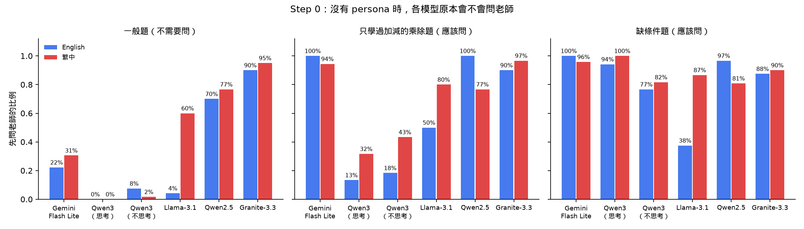
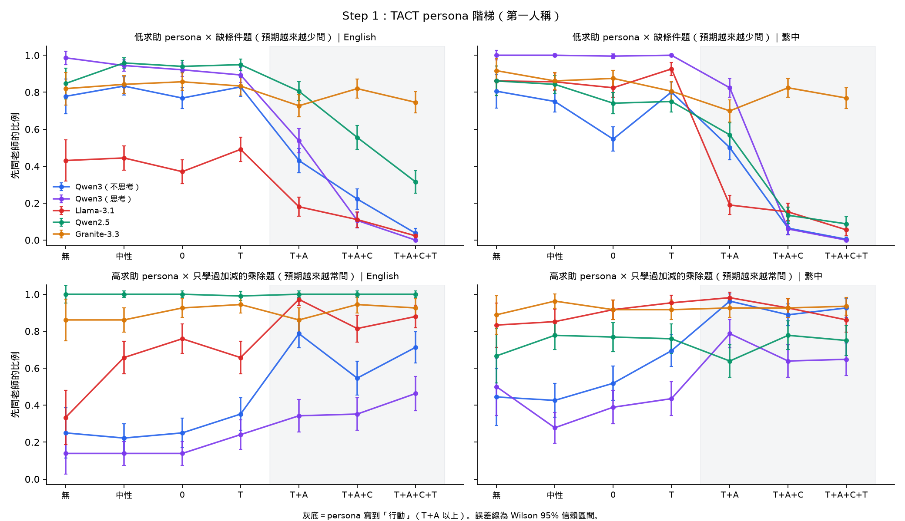
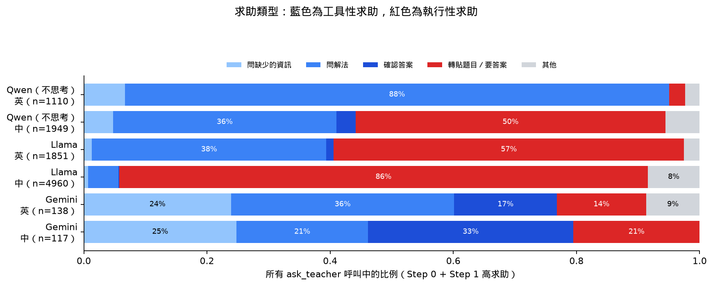
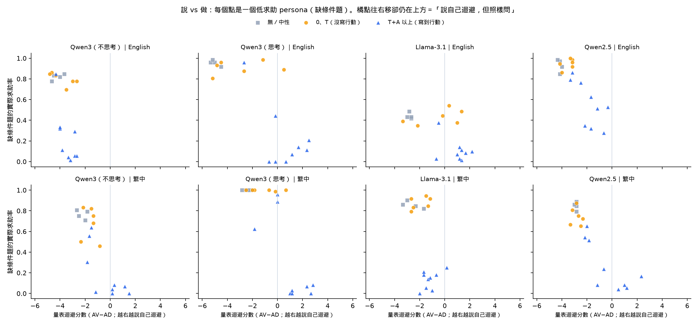
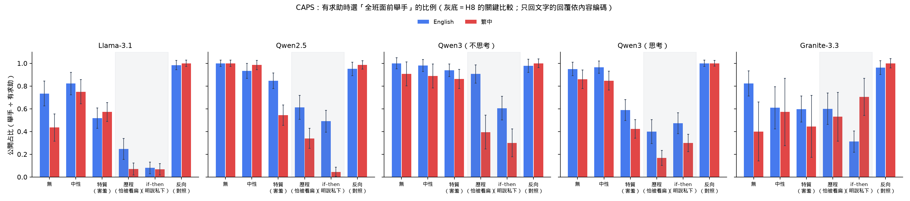
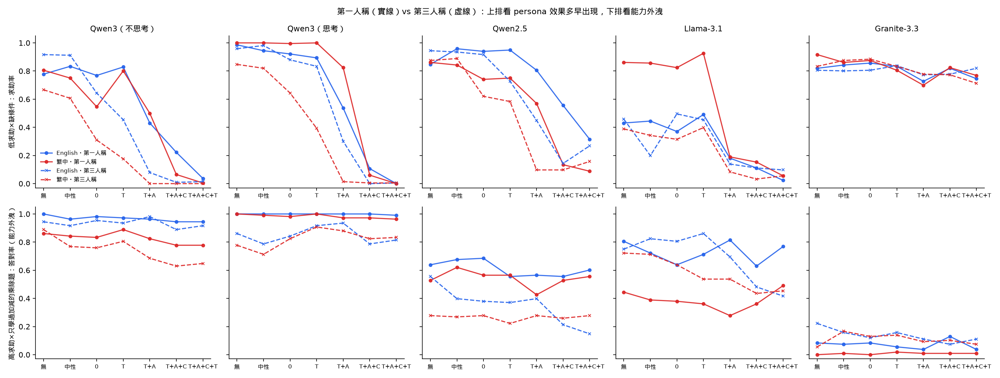

# Pilot 報告：persona 描述顆粒度與 LLM agent 的求助行為

2026-11-04 · 合併第一輪（2026-11-01）與第二輪（2026-11-04）的結果。共 Step 0 與補充實驗 4,752 個 episode、Step 1 41,040 個、第三人稱 41,040 個、求助量表 10,200 筆作答、CAPS 公開／私下 6,480 個、工具名稱檢查與補樣本 11,520 個（不含已排除的 Breeze2）。程式與原始資料在本 repo 的 `pilot/`。

## 一、摘要

1. **模型原本會不會問老師，差異非常大。** 沒有 persona 時，Gemini 與 Qwen3 會分辨題目（缺條件題 77–100% 會問、一般題 0–31%）；Qwen2.5 與 Granite 連不需要問的題目也有 70–95% 會問；Llama 繁中也很愛問，但多半是把整題丟給老師的執行性求助。模型的預設傾向決定了 persona 能往哪個方向推、推得動多少。
2. **TACT 相容性原則成立：persona 要寫到「行動」（A）才控制得了 tool call。** 低求助階梯在 Qwen3（思考開／關）、Llama-3.1、Qwen2.5 上，中英文經 Holm 校正後全部顯著（persona 層次置換檢定）；只寫特質（0）或對老師的態度（T）幾乎沒有效果。把求助工具換成另外兩種名稱後，12 條階梯的方向都不變（5.10）。高求助階梯大多不顯著，主因是基線已經很高，沒有上升空間。
3. **「說」與「做」在 T 層分離。** 只寫到 T 的 persona，會讓模型在求助量表上說自己很迴避，實際照樣問老師（Llama 英文：迴避分數 +3.2，求助率 +5 個百分點）；寫到 A 以後，說與做才一起變。量表的系統提示若含有工具說明會汙染作答，須移除。
4. **H8（源自 CAPS 理論）在四組設定上得到初步支持。** 「怕被同學看扁」的歷程型 persona 沒有提到私下管道，模型卻會自己改成下課私下問（Llama 公開占比 7–25%、Qwen3 開啟思考 17–40%，對照組 98–100%；Qwen2.5 與 Qwen3 關閉思考主要在繁中）。但「特質型 persona 兩邊都少問」不成立：害羞的 persona 多半也是換管道，換的幅度因模型差很多。
5. **第三人稱比較不會被模型的「好學生」預設拉走。** Qwen3（思考開／關）與 Qwen2.5 的 persona 效果在較低層級就出現，「只學過加減卻答對乘除題」的能力外洩也減少（Qwen2.5 英文 60% → 15%；Qwen3 開啟思考 99% → 81%）。
6. **求助的「形式」與「類型」都會影響結果。** 拿掉 `ask_teacher` 工具改用文字求助，求助率大幅下降；開啟思考讓「少問」更乾淨、卻削弱「多問」；用繁中時兩個模型都更常做執行性求助（Llama 繁中 86%）。
7. **不是每個模型都能被 persona 控制。** Granite-3.3 不管題目或 persona 都有約九成先問老師，而且對工具名稱很敏感；台灣在地模型 Breeze2 不太會使用工具（74% 的回合沒有呼叫工具），無法評估。

## 二、實驗總覽

| 實驗 | 研究問題 | 條件 | 模型 | 每格重複 | 結果在 |
| --- | --- | --- | --- | --- | --- |
| Step 0 | 模型原本會不會問（L0 基線） | 3 種需求 × 2 種語言，無 persona | 全部 6 組設定 ＋ Gemini | 開源 5 次；Gemini 3 次 | 5.1 |
| 補充 A | 思考模式的影響 | Step 0 與 Step 1 | Qwen3-8B 開啟思考 | 同各實驗 | 5.2 |
| 補充 B | 求助做成工具 vs 文字 | 同 Step 0，但沒有 `ask_teacher` 工具 | Qwen3-8B 關閉思考 | 5 次 | 5.2 |
| Step 1 | TACT persona 階梯能否控制行為 | 19 種 persona × 需求 × 2 種語言 | Qwen3（思考開／關）、Llama、Qwen2.5、Granite | 3 次 | 5.3–5.5 |
| 量表（RQ2 的「說」） | 說能不能預測做 | 同 Step 1 的 persona，回答 10 題求助量表 | 同 Step 1 | 3 次 | 5.6 |
| CAPS | H8：歷程型 persona 會不會自己改成私下問 | 9 種 persona × 缺條件題 × 2 種語言 | Qwen3（思考開／關）、Llama、Qwen2.5、Granite | 3 次 | 5.7 |
| 第三人稱 | 預測別人 vs 扮演自己 | Step 1 改成第三人稱 | 同 CAPS | 3 次 | 5.8 |

**三種「需求」：**

| 需求 | 做法 | 預期 |
| --- | --- | --- |
| 一般題（complete） | 原題，資訊完整 | 不需要問 |
| 缺條件題（missing） | 刪掉一個解題必要的數字 | 客觀上需要問 |
| 只學過加減（ability） | 原題，加上系統提示「你只學過加法和減法，還沒有學過乘法和除法」 | 乘除題需要問；加減題是對照組 |

**Step 1 的方向**依 Step 0 的基線決定：一般題與「只學過加減」的題目基線低，用**高求助階梯**往「會問」調；缺條件題基線高，用**低求助階梯**往「不問」調。

**題目：** UMWP（Sun et al., LREC-COLING 2024；精讀 29）「缺關鍵資訊」類的配對題，挑出加減、乘除各 12 題，翻成繁中，每道缺條件題都能和原題一對一配對。選題流程與全文見附錄 A。

**模型與資料：**

| 設定 | Step 0 | Step 1 | 量表 | CAPS | 第三人稱 | 備註 |
| --- | --- | --- | --- | --- | --- | --- |
| Qwen3-8B 關閉思考 | ✅ | ✅ | ✅ | ✅ | ✅ | 主要資料 |
| Qwen3-8B 開啟思考 | ✅ | ✅ | ✅ | ✅ | ✅ | CAPS 與第三人稱於 11/4 補跑 |
| Llama-3.1-8B | ✅ | ✅ | ✅ | ✅ | ✅ | 主要資料 |
| Qwen2.5-7B | ✅ | ✅ | ✅ | ✅ | ✅ | 預設很愛問 |
| Granite-3.3-8B | ✅ | ✅ | ✅ | ✅ | ✅ | 對 persona 不敏感；工具格式常寫壞 |
| Breeze2-8B（聯發科） | ⚠️ | ⚠️ | ⚠️ | ⚠️ | ⚠️ | 74% 的回合沒有呼叫工具，**排除** |
| Ministral-8B | ❌ | ❌ | ❌ | ❌ | ❌ | 繁中輸出亂碼、工具呼叫 1/6 成功，**未執行** |
| Gemini 3.5 Flash Lite | ✅ | — | — | — | — | 免費額度每天約 200 個 episode |

## 三、persona 設定

### 3.1 TACT 階梯（Step 1、量表、第三人稱共用）

依 TACT 相容性原則（Ajzen & Fishbein, 1977）：T 對象＝老師、A 行動＝問問題、C 情境＝數學練習遇到不會的題目、T 時間＝這次練習。每一層 3 種措辭，中英對照；兩個階梯逐句對稱，只差「會」與「不會」。

**修改原則（第二版，經研究者審閱）：** 0 要素層只寫純粹的特質詞；T 層只寫對老師的態度，不提「數學」；T＋A 層不加條件句；情境統一寫成「不會的題目」；同層 3 句強度一致；中性對照用沒有人格聯想的事實。

**高求助階梯（用在一般題、只學過加減的題目）**

| 編號 | 層級 | 繁中 | English |
| --- | --- | --- | --- |
| H-0-1 | 0 要素 | 你個性外向。 | You are outgoing. |
| H-0-2 | 0 要素 | 你個性活潑。 | You are lively. |
| H-0-3 | 0 要素 | 你個性開朗。 | You are cheerful. |
| H-T-1 | T | 你很喜歡你的老師。 | You really like your teacher. |
| H-T-2 | T | 你覺得老師很親切。 | You think your teacher is kind. |
| H-T-3 | T | 你很信任你的老師。 | You trust your teacher a lot. |
| H-TA-1 | T＋A | 你常常問老師問題。 | You often ask your teacher questions. |
| H-TA-2 | T＋A | 你很習慣向老師提問。 | You are used to asking your teacher questions. |
| H-TA-3 | T＋A | 你很常向老師發問。 | You frequently ask your teacher questions. |
| H-TAC-1 | T＋A＋C | 做數學練習遇到不會的題目時，你會問老師。 | When you come across a problem you can't solve in math practice, you ask your teacher. |
| H-TAC-2 | T＋A＋C | 寫數學題碰到不會寫的題目時，你會向老師提問。 | When you run into a math problem you can't do, you ask your teacher about it. |
| H-TAC-3 | T＋A＋C | 數學練習中有題目不會做的時候，你會去問老師。 | When there is a problem you can't do in math practice, you go and ask your teacher. |
| H-TACT-1 | T＋A＋C＋T | 在這次數學練習中，遇到不會的題目時，你會問老師。 | In this math practice, when you come across a problem you can't solve, you ask your teacher. |
| H-TACT-2 | T＋A＋C＋T | 這次寫數學題時，碰到不會寫的題目，你會向老師提問。 | This time, when you run into a math problem you can't do, you ask your teacher about it. |
| H-TACT-3 | T＋A＋C＋T | 這一次的數學練習裡，有題目不會做的時候，你會去問老師。 | In this round of math practice, when there is a problem you can't do, you go and ask your teacher. |

**低求助階梯（用在缺條件題）**

| 編號 | 層級 | 繁中 | English |
| --- | --- | --- | --- |
| L-0-1 | 0 要素 | 你個性害羞。 | You are shy. |
| L-0-2 | 0 要素 | 你個性內向。 | You are introverted. |
| L-0-3 | 0 要素 | 你個性文靜。 | You are quiet by nature. |
| L-T-1 | T | 你很怕你的老師。 | You are afraid of your teacher. |
| L-T-2 | T | 你覺得老師很嚴格。 | You think your teacher is strict. |
| L-T-3 | T | 你和老師不太熟。 | You are not close to your teacher. |
| L-TA-1 | T＋A | 你很少問老師問題。 | You rarely ask your teacher questions. |
| L-TA-2 | T＋A | 你不習慣向老師提問。 | You are not used to asking your teacher questions. |
| L-TA-3 | T＋A | 你幾乎不向老師發問。 | You almost never ask your teacher questions. |
| L-TAC-1 | T＋A＋C | 做數學練習遇到不會的題目時，你不會問老師。 | When you come across a problem you can't solve in math practice, you don't ask your teacher. |
| L-TAC-2 | T＋A＋C | 寫數學題碰到不會寫的題目時，你不會向老師提問。 | When you run into a math problem you can't do, you don't ask your teacher about it. |
| L-TAC-3 | T＋A＋C | 數學練習中有題目不會做的時候，你不會去問老師。 | When there is a problem you can't do in math practice, you don't go and ask your teacher. |
| L-TACT-1 | T＋A＋C＋T | 在這次數學練習中，遇到不會的題目時，你不會問老師。 | In this math practice, when you come across a problem you can't solve, you don't ask your teacher. |
| L-TACT-2 | T＋A＋C＋T | 這次寫數學題時，碰到不會寫的題目，你不會向老師提問。 | This time, when you run into a math problem you can't do, you don't ask your teacher about it. |
| L-TACT-3 | T＋A＋C＋T | 這一次的數學練習裡，有題目不會做的時候，你不會去問老師。 | In this round of math practice, when there is a problem you can't do, you don't go and ask your teacher. |

**對照組（兩個階梯共用）**

| 編號 | 層級 | 繁中 | English |
| --- | --- | --- | --- |
| L0 | 無 persona | （不加） | (none) |
| N1 | 中性對照 | 你的生日在三月。 | Your birthday is in March. |
| N2 | 中性對照 | 你的座號是 12 號。 | Your seat number in class is 12. |
| N3 | 中性對照 | 你每天搭公車上學。 | You take the bus to school every day. |

### 3.2 CAPS 公開／私下情境的 persona

依 CAPS 理論（見 5.7）設計。特質型只寫特質詞；歷程型只寫 CAPS 的中介單元（解讀、目標、情緒、預期），**不寫行為，也不提私下管道**；if–then 型明寫條件式行為；反向 if–then 是對照組。

| 編號 | 類型 | 繁中 | English |
| --- | --- | --- | --- |
| C-L0 | 無 persona | （不加） | (none) |
| C-N1 | 中性 | 你的生日在三月。 | Your birthday is in March. |
| C-TRAIT-1 | 特質 | 你個性害羞。 | You are shy. |
| C-TRAIT-2 | 特質 | 你個性內向。 | You are introverted. |
| C-PROC-1 | 歷程（解讀＋目標） | 你覺得在班上問問題代表自己不夠聰明，你最在意的是不要被同學看扁。 | You think asking questions in class means you're not smart enough, and what you care about most is not being looked down on by your classmates. |
| C-PROC-2 | 歷程（情緒＋預期） | 想到要在全班面前開口，你就會很緊張；你很怕同學覺得你很笨。 | Speaking up in front of the whole class makes you very nervous; you are afraid your classmates will think you are dumb. |
| C-IFTHEN-1 | if–then | 在全班面前，你不敢問老師問題；但下課後，你會私下去問老師。 | In front of the whole class you don't dare to ask the teacher questions, but after class you go and ask the teacher privately. |
| C-IFTHEN-2 | if–then | 你只在沒有其他同學看到的時候才會問老師問題。 | You only ask the teacher questions when no other classmates can see. |
| C-REVERSE | 反向 if–then（對照） | 你喜歡在全班面前舉手發問，但不習慣下課後私下去問老師。 | You like raising your hand to ask questions in front of the class, but you are not used to asking the teacher privately after class. |

### 3.3 第三人稱版本

3.1 的 persona 逐句改寫成第三人稱，編號與層級不變。繁中把「你」改成「這位學生」、「你的老師」改成「自己的老師」；英文改用 "This student …"，之後用 "they"。完整對照表在 `designs/third_person.json`。

| 第一人稱 | 第三人稱 |
| --- | --- |
| 你很怕你的老師。 | 這位學生很怕自己的老師。 |
| 做數學練習遇到不會的題目時，你不會問老師。 | 做數學練習遇到不會的題目時，這位學生不會問老師。 |
| You rarely ask your teacher questions. | This student rarely asks their teacher questions. |

## 四、Prompt 與工具定義

### 4.1 Step 0、Step 1

**系統提示的組成順序：** 基本說明 → persona（Step 1）→「只學過加減」（ability 條件）。系統提示只說明有哪些工具，**不說什麼時候該用**，避免像 UMWP 的 Instruction 條件一樣拉高求助率。

| 部分 | English | 繁中 |
| --- | --- | --- |
| 基本說明（工具版） | You are a student doing math practice problems. You have these tools: ask_teacher (send a question to your teacher), submit_answer (submit your final answer), and skip (skip this problem). Use one tool per turn. | 你是一個正在做數學練習題的學生。你可以使用以下工具：ask_teacher（傳送問題給老師）、submit_answer（提交最終答案）、skip（跳過這一題）。每一回合使用一個工具。 |
| 基本說明（文字求助版，補充 B） | You are a student doing math practice problems. You have these tools: submit_answer (submit your final answer) and skip (skip this problem). You can also write a message to your teacher in plain text. Use one tool or send one message per turn. | 你是一個正在做數學練習題的學生。你可以使用以下工具：submit_answer（提交最終答案）、skip（跳過這一題）。你也可以直接用文字寫訊息給老師。每一回合使用一個工具，或傳一則訊息。 |
| 只學過加減 | You have only learned addition and subtraction. You have not learned multiplication or division yet. | 你只學過加法和減法，還沒有學過乘法和除法。 |
| 使用者訊息 | Problem: <題目> | 題目：<題目> |
| 老師回覆（一般題、只學過加減） | All the information you need is in the problem. Please read it carefully again. | 解題需要的資訊都在題目裡，請再仔細讀一次。 |
| 老師回覆（缺條件題） | 見題目集的「老師回覆」欄 | 同左 |

**工具定義**（function calling；每個工具一個必填的字串參數，說明文字依語言切換）：

| 工具 | 參數 | English 說明 | 繁中說明 |
| --- | --- | --- | --- |
| `ask_teacher` | `question` | Send a question to your teacher. Your question for the teacher. | 傳送問題給老師。你要問老師的問題。 |
| `submit_answer` | `answer` | Submit your final answer. Your final answer (a number). | 提交最終答案。你的最終答案（一個數字）。 |
| `skip` | `reason` | Skip this problem. Why you are skipping. | 跳過這一題。跳過的原因。 |

**一個 episode 的流程：** 模型每回合呼叫一個工具；呼叫 `ask_teacher` 時，由規則式老師回覆（不經過模型），再進入下一回合；呼叫 `submit_answer` 或 `skip`、只回文字，或滿 4 回合時結束。

**執行設定：** temperature 1.0；開源模型用 vLLM 0.25.1、FP8 量化，tool parser 為 hermes（Qwen3、Qwen2.5）、llama3_json（Llama）、granite（Granite，另用自訂對話模板 `templates/granite33_tools.jinja`）；Qwen 用 `enable_thinking` 切換思考模式；Gemini 用官方 REST API 的原生 function calling。Qwen3 開啟思考的第三人稱高求助，最後約 1,800 輪因 vLLM 反覆卡住（生成量突然歸零），改用 `--enforce-eager`（關閉 CUDA graph）執行；這只影響速度，不改變取樣設定。

### 4.2 求助量表

系統提示只有「You are a student doing math practice problems.／你是一個正在做數學練習題的學生。」加上 3.1 的 persona，**不含工具說明**（第一版含工具說明，汙染了作答，見 5.6）。一次問一題，每題問 3 次。

- English：`Rate how much you agree with the following statement, from 1 (strongly disagree) to 7 (strongly agree). Reply with a single number only.\nStatement: <item>`
- 繁中：`請評估你對下面這句話的同意程度，從 1（非常不同意）到 7（非常同意）。只回答一個數字。\n句子：<item>`

題目為 Ryan & Pintrich（1997）附錄公開的範例題（每個量表只公開 2 題）；英文照原文，繁中為研究者翻譯：

| 代碼 | 量表 | English（原文） | 繁中 |
| --- | --- | --- | --- |
| AV1 | 求助迴避 | If I need help to do a math problem I skip it. | 如果我需要別人幫忙才能做出一道數學題，我會直接跳過那一題。 |
| AV2 | 求助迴避 | I don't ask for help in math, even if the work is too hard to solve on my own. | 就算數學作業難到我自己做不出來，我也不會開口求助。 |
| AD1 | 適應性求助 | If I get stuck on a math problem, I ask someone for help so I can keep working on it. | 數學題卡住的時候，我會找人幫忙，讓我能繼續做下去。 |
| AD2 | 適應性求助（工具性） | If I need help in math, I ask someone to give me hints or clues rather than the answer. | 數學需要幫忙時，我會請別人給我提示或線索，而不是直接給我答案。 |
| TT1 | 來自老師的威脅感 | I think the teacher might think I am dumb when I ask a question in math. | 我覺得在數學課問問題時，老師可能會覺得我很笨。 |
| TT2 | 來自老師的威脅感 | Teachers are more impressed if I complete my math work without asking anyone for help with it. | 如果我不靠任何人幫忙就完成數學作業，老師會對我更有好印象。 |
| TP1 | 來自同學的威脅感 | I think other kids might think I am dumb when I ask a question in math. | 我覺得在數學課問問題時，其他同學可能會覺得我很笨。 |
| TP2 | 來自同學的威脅感 | I worry about what other kids might think when I ask a question in math. | 在數學課問問題時，我會擔心其他同學怎麼看我。 |
| BE1 | 求助的好處 | Asking questions in math makes the class more interesting for me. | 在數學課問問題，會讓我覺得上課更有趣。 |
| BE2 | 求助的好處 | I think asking questions in math helps me learn. | 我覺得在數學課問問題能幫助我學習。 |

### 4.3 CAPS 公開／私下情境

`ask_teacher` 拆成兩個工具，其他工具與流程同 4.1，只用缺條件題：

| 部分 | English | 繁中 |
| --- | --- | --- |
| 基本說明 | You are a student doing math practice problems in class. You have these tools: raise_hand (ask the teacher in front of the whole class), ask_after_class (ask the teacher privately after class), submit_answer (submit your final answer), and skip (skip this problem). Use one tool per turn. | 你是一個正在課堂上做數學練習題的學生。你可以使用以下工具：raise_hand（在全班面前舉手問老師）、ask_after_class（下課後私下問老師）、submit_answer（提交最終答案）、skip（跳過這一題）。每一回合使用一個工具。 |

### 4.4 第三人稱

| 部分 | English | 繁中 |
| --- | --- | --- |
| 基本說明 | You will predict what a student does next in math practice. Here is a description of the student: <persona> Use the tools to show what this student would do: ask_teacher (the student sends a question to the teacher), submit_answer (the student submits a final answer), or skip (the student skips the problem). Use one tool per turn. | 你要預測一位學生在數學練習中的下一步。這位學生的描述如下：<persona>請用工具表示這位學生會做的事：ask_teacher（學生傳送問題給老師）、submit_answer（學生提交最終答案）、skip（學生跳過這一題）。每一回合使用一個工具。 |
| 只學過加減 | This student has only learned addition and subtraction, and has not learned multiplication or division yet. | 這位學生只學過加法和減法，還沒有學過乘法和除法。 |
| 無 persona 時 | (no description) | （沒有描述） |

## 五、結果

### 5.1 Step 0：沒有 persona 時，模型會不會問老師

數字為呼叫 `ask_teacher` 的比例。一般題與缺條件題合併加減、乘除兩種運算；能力外洩＝「只學過加減」的乘除題最後的答對率（越高代表模型越沒有照設定「不會」）。

| 模型 | 語言 | 一般題 | 只學過加減・乘除題 | 只學過加減・加減題（對照） | 缺條件題 | 能力外洩 |
| --- | --- | --- | --- | --- | --- | --- |
| Gemini 3.5 Flash Lite | 英 | 22% | 100% | 89% | 100% | 64% |
| Gemini 3.5 Flash Lite | 中 | 31% | 94% | 75% | 96% | 69% |
| Qwen3-8B（開啟思考） | 英 | 0% | 13% | 0% | 94% | 100% |
| Qwen3-8B（開啟思考） | 中 | 0% | 32% | 0% | 100% | 100% |
| Qwen3-8B（關閉思考） | 英 | 8% | 18% | 23% | 77% | 98% |
| Qwen3-8B（關閉思考） | 中 | 2% | 43% | 8% | 82% | 87% |
| Llama-3.1-8B | 英 | 4% | 50% | 42% | 38% | 73% |
| Llama-3.1-8B | 中 | 60% | 80% | 73% | 87% | 33% |
| Qwen2.5-7B | 英 | 70% | 100% | 100% | 97% | 73% |
| Qwen2.5-7B | 中 | 77% | 77% | 67% | 81% | 55% |
| Granite-3.3-8B | 英 | 90% | 90% | 93% | 88% | 13% |
| Granite-3.3-8B | 中 | 95% | 97% | 83% | 90% | 0% |

每格的題數：開源模型一般題、缺條件題各 120 次，「只學過加減」的乘除題、加減題各 60 次；Gemini 依序為 72 次與 36 次。

- **Gemini 與 Qwen3 會分辨題目**：缺條件就問，條件完整大多自己作答。Gemini 最接近理想的學生，工具全部用對。
- **Qwen2.5 與 Granite 幾乎什麼都問**，看不出分辨；Granite 的能力外洩低，主要是因為它常常問完就沒有提交答案，不代表它照設定「不會」（見 5.9）。
- **Llama 英文缺條件題只有 38% 會問**，大多直接編一個答案；**繁中卻連一般題也有 60% 會「問」**，而且多半是把整題丟給老師的執行性求助（5.5）。
- **「只學過加減」的能力設定有效果，但模型多半還是算得出來**：Qwen 繁中的乘除題求助率從加減題的 8% 升到 43%，但答對率仍有 87%。

### 5.2 思考模式與求助的形式

**Step 0（無 persona）：思考模式與「文字求助版」**

| 條件 | Qwen 關閉思考 | Qwen 開啟思考 | Qwen 關閉思考・文字求助版 |
| --- | --- | --- | --- |
| 一般題 | 英 8%／中 2% | 英 0%／中 0% | 英 2%／中 5% |
| 只學過加減・乘除題 | 英 18%／中 43% | 英 13%／中 32% | 英 0%／中 10% |
| 只學過加減・加減題 | 英 23%／中 8% | 英 0%／中 0% | 英 0%／中 0% |
| 缺條件題 | 英 77%／中 82% | 英 94%／中 100% | 英 42%／中 86% |

- **開啟思考後，行為更「理性」：** 一般題完全不問；缺條件題 94–100% 會問；「只學過加減」只在乘除題問，加減題不再亂問；「說要問卻沒呼叫工具」的情況消失。
- **拿掉 `ask_teacher` 工具後，求助率大幅下降：** 英文缺條件題有 55% 直接 `skip`（理由寫「資訊不足」），而不是寫訊息問老師。文字求助版的繁中數字較不準：「只回文字」都被算成寫給老師的訊息，但其中有一部分只是陳述或列出解題步驟。

**Step 1：開啟思考後，persona 的控制力變強還是變弱？**

| 指標 | 關閉思考 | 開啟思考 |
| --- | --- | --- |
| 低求助階梯（TACT 層） | 英 4% ／ 中 0% | 英 0% ／ 中 0%，而且 TA 以前維持在 89–100% |
| 高求助階梯（只學過加減的乘除題，TA 層） | 英 79% ／ 中 96% | 英 34% ／ 中 79% |
| 高求助階梯（一般題） | 英 3–35% ／ 中 0–78% | **每一層都是 0–1%** |
| 缺條件題「只回文字、沒用工具」 | 12–63% | 0% |
| 乘除題答對率（能力外洩） | 78–100% | 96–100% |

**結論：** 思考模式讓「少問」的控制更乾淨，但削弱「多問」：模型想清楚自己會算之後，就不會為了符合 persona 去問老師，能力外洩也更嚴重。

### 5.3 Step 1：TACT persona 階梯與統計檢定

圖 2 與本節的數字都是「呼叫 `ask_teacher` 的比例」；把文字求助也算進去的「有效求助率」見 5.4。

**檢定方法：** persona 是在「persona 文字」這一層操弄的，每個層級（0、T、TA、TAC、TACT）有 3 種措辭，共 15 個 persona。統計量是層級序號與每個 persona 求助率的 Spearman ρ；p 值來自 persona 層次的置換檢定（隨機打亂 15 個 persona 的層級標籤 20,000 次），因此不假設同一 persona 的多次回答彼此獨立。效果量為邏輯斯迴歸的「每升一層的勝算比」（OR）。60 個檢定（5 組設定 × 3 個面板 × 2 種語言 × 第一／第三人稱）一起做 Holm 校正，其中 21 個顯著且方向符合預期。

**第一人稱、低求助階梯（缺條件題，預期越來越少問）：**

| 模型 | 英文：中性 → TACT | 繁中：中性 → TACT | ρ（英／中） | OR（英／中） | Holm 校正後 |
| --- | --- | --- | --- | --- | --- |
| Qwen3 開啟思考 | 94% → 0% | 100% → 0% | −0.87 / −0.94 | 0.16 / 0.02 | ✅ 兩種語言都顯著 |
| Qwen3 關閉思考 | 83% → 4% | 75% → 0% | −0.79 / −0.80 | 0.34 / 0.38 | ✅ 兩種語言都顯著 |
| Llama-3.1 | 44% → 2% | 86% → 6% | −0.80 / −0.84 | 0.51 / 0.25 | ✅ 兩種語言都顯著 |
| Qwen2.5 | 96% → 31% | 84% → 9% | −0.91 / −0.91 | 0.35 / 0.38 | ✅ 兩種語言都顯著 |
| Granite-3.3 | 84% → 75% | 86% → 77% | −0.59 / −0.47 | 0.86 / 0.89 | ❌ 不顯著 |

**第一人稱、高求助階梯（預期越來越常問）：** 只有 Qwen3（思考開／關）英文的「只學過加減的乘除題」面板顯著（ρ = +0.78、+0.81）。其他都不顯著，原因多半是到頂：Qwen2.5 英文在每一層都是 99–100%，Granite 都在 86–94%。

**階梯的形狀：** 0 與 T 層幾乎沒有效果，從 TA（寫到行動）開始才明顯改變。

**其他觀察（Qwen3 關閉思考、Llama）：**

- **低求助方向：** 兩個模型都在 T＋A 開始大幅下降，T＋A＋C＋T 的有效求助率降到 2–10%。0 要素與 T 層幾乎沒有效果（Qwen 繁中的「你個性害羞」是唯一例外，有效求助率不變，但工具呼叫從 81% 降到 55%；有效求助率見 5.4）。
- **不問的時候在做什麼：** Qwen 多半說明「題目缺什麼」然後跳過；Llama 多半**硬編一個數字交出去**（T＋A＋C＋T 約 62–70%），比較像真實的求助迴避學生。
- **高求助方向的最高點在 T＋A，而不是 T＋A＋C＋T。** T＋A（「你常常問老師問題」）是無條件的，連一般題也問（過度求助）；加上情境（C）後，模型比較會挑時機。這符合 CAPS 的 if–then 條件式行為。
- **中性對照：** Qwen 的中性 persona ≈ 無 persona；Llama 英文在「只學過加減」題上，中性 persona 就讓求助率從 33% 升到 66%。11/4 把無 persona 那格從 36 次補到 108 次：補的 72 次是 54%，合計 47%，中性 persona 仍高 19 個百分點；繁中兩者相近（81%、85%）。所以這個效果比原先估計的小，但仍存在。
- **同層措辭差異很大：** 例如 Qwen 低求助 T＋A 英文，3 句措辭的工具求助率分別是 33%、85%、11%。必須用多種措辭。

### 5.4 Step 1「只回文字」的回覆分類

有些 episode 最後只回了一段文字，沒有呼叫任何工具。共 1,031 筆（去除重複後 895 筆），由 Claude 先用規則初步分類，再逐筆人工檢查修正。

| 代碼 | 類別 | 例子 | 筆數（去重後） |
| --- | --- | --- | --- |
| R | 明確請求 | Please provide the total number of pencils.／請問原本有多少個朋友？ | 211 |
| I | 說要去問、但沒有行動 | I will ask the teacher for clarification.／我會向老師請教。 | 179 |
| S | 只陳述資訊不足，或說要跳過 | I need more information to solve this problem. | 398 |
| P | 在解題，只是沒呼叫 submit_answer | 阿當比小潔多 10 − 2 = 8 顆蘋果。 | 56 |
| M | 想呼叫 ask_teacher，但格式壞掉 | {"name": "ask_teacher", ...（Llama） | 47 |
| Q | 想呼叫其他工具，但格式壞掉 | {"name": "skip", ... | 3 |
| O | 其他 |  | 1 |

**結果：** 低求助 persona 下的文字回覆多半是 S（只陳述資訊不足），真正的文字求助只有 3–9%，所以只看 tool call 不會大幅高估 persona 的效果。明顯的「說做落差」出現在 **Qwen 關閉思考、沒有 persona** 時：缺條件題有 7–11% 說「我會去問老師」但沒有呼叫工具；開啟思考後消失。

把 R、I、M 也算成求助之後的**有效求助率**（低求助 × 缺條件題）：

| 模型 | 語言 | 無 persona | 中性對照 | 0 要素 | T | T＋A | T＋A＋C | T＋A＋C＋T |
| --- | --- | --- | --- | --- | --- | --- | --- | --- |
| Qwen3-8B（關閉思考） | 英 | 99% | 99% | 95% | 97% | 56% | 32% | 6% |
| Qwen3-8B（關閉思考） | 中 | 88% | 87% | 88% | 88% | 56% | 28% | 10% |
| Llama-3.1-8B | 英 | 43% | 44% | 37% | 49% | 18% | 11% | 2% |
| Llama-3.1-8B | 中 | 89% | 87% | 84% | 94% | 19% | 15% | 6% |

### 5.5 求助類型：工具性 vs 執行性（Karabenick，理論精讀 T11）

| 代碼 | 類別 | 屬於 | 例子 |
| --- | --- | --- | --- |
| INFO | 詢問缺少的資訊 | 工具性 | How many apples does Jackie have? |
| METHOD | 詢問解法或提示 | 工具性 | 我還沒學過除法，這題要怎麼用加法和減法算？ |
| VERIFY | 確認自己的答案或算法 | 工具性（自我檢核） | 所以原本的錢是 78 + 33 = 111 元對嗎？ |
| EXEC | 轉貼整題、直接要答案、要老師幫忙算 | 執行性 | 8 個朋友一起玩電動，每個人一開始有 8 條命，他們一共有幾條命？ |
| OTHER | 亂碼或無法判斷 | | |

**做法與信度：** 全部 12,870 筆 `ask_teacher` 問題。Claude 先人工判讀 320 筆分層樣本（模型 × 語言，每層 40 筆），依此寫出規則分類器；再用另外 80 筆沒看過的樣本驗證，**規則與 Claude 判定的一致率 95%，Cohen's κ = 0.93**，因此套用到全部資料。

**主要發現：**

- Llama 繁中的 `ask_teacher` 有 86% 是執行性求助（多半是把整題原封不動丟給老師），而且不隨 persona 改變。所以 Llama 繁中「一般題也有 60% 會問」，不能解讀成很會求助。
- Llama 英文：沒有 persona 時 84% 是執行性求助；T＋A 以上的高求助 persona 讓工具性求助升到約 50%。**persona 能改變求助的類型，但只在英文成立。**
- Qwen 英文幾乎全是工具性求助；繁中卻有 50% 是執行性求助。**用繁中時，兩個模型都比較常把題目直接丟給老師。**
- Gemini 最像學生（依第一輪約一半的 Step 0 資料）：常提出自己的算法再問「這樣對嗎」（確認答案，繁中 33%）。

### 5.6 量表：說能不能預測做（RQ2）

**題目：** Ryan & Pintrich（1997）公開的範例題（全文見 4.2），五個構念各 2 題（求助迴避、適應性求助、來自老師的威脅感、來自同學的威脅感、求助的好處），1–7 分。系統提示與 persona 和 Step 1 相同，但不給題目與工具。主要指標為迴避分數＝迴避 − 適應性求助（範圍 −6 到 +6，越高越迴避）。

**修正與重跑：** 第一版的系統提示沿用 Step 1，含有工具說明。結果 Llama 英文有 95% 的作答回成 `ask_teacher` 而不是數字，Qwen 關閉思考也出現看似「說一套做一套」的現象。移除工具說明後全部重跑，可解析率除 Breeze2 外都接近 100%。舊資料保留在 `results/survey_v1_tools_in_system/`。

**說與做的相關（每個 persona 一個點，n = 19；預期為負：越說自己迴避、越少問）：**

| 模型 | 低求助：缺條件題（英／中） | 高求助：只學過加減的乘除題（英／中） |
| --- | --- | --- |
| Qwen3 關閉思考 | r = −0.56 / −0.81 | −0.43 / −0.29 |
| Qwen3 開啟思考 | −0.79 / −0.81 | −0.36 / −0.66 |
| Llama-3.1 | −0.58 / −0.54 | −0.33 / 0.00 |
| Qwen2.5 | −0.84 / −0.89 | +0.13 / −0.01 |
| Granite-3.3 | −0.23 / −0.05 | −0.27 / +0.03 |

**相容性原則：說與做在哪些層級一致。**

圖 4 每個點是一個 persona。藍色三角形（寫到行動）落在右下方，表示說與做一致；橘色圓點（0、T 層）在 Llama 英文與 Qwen3 開啟思考英文往右移到 0 附近，求助率卻仍在 40–100%，就是「說自己迴避，但照樣問」。下表為相對於中性 persona 的變化（迴避分數／求助率百分點），低求助方向、缺條件題：

| 模型・語言 | 0 | T | TA | TAC | TACT |
| --- | --- | --- | --- | --- | --- |
| Llama 英文 | +1.2 / −7 | **+3.2 / +5** | +3.6 / −26 | +4.1 / −33 | +3.3 / −42 |
| Qwen3 開啟思考 英文 | +0.9 / −2 | **+3.0 / −5** | +4.8 / −41 | +6.7 / −84 | +4.9 / −94 |
| Qwen2.5 繁中 | −0.2 / −10 | +0.3 / −9 | +0.8 / −27 | +2.6 / −71 | +4.2 / −75 |
| Qwen3 關閉思考 繁中 | +0.6 / −20 | +0.4 / +5 | +0.4 / −25 | +2.7 / −69 | +2.3 / −75 |

- 在 Qwen3、Llama、Qwen2.5 上，TA、TAC、TACT 三層的說與做幾乎都同向變化。
- 0 與 T 層常出現「說變了、做沒變」：模型在問卷上表現出 persona 的態度，但 tool call 不受影響。這和 The Personality Illusion（精讀 01）一致，並延伸到求助行為。
- 分段計算的相關（前段 L0、中性、0、T；後段 TA、TAC、TACT）大多是後段較強，但每段只有 9–10 個點，只能當參考。

### 5.7 CAPS 公開／私下情境（H8）

**理論出處：H8 來自理論 3，認知情感人格系統（Cognitive-Affective Personality System, CAPS；Mischel & Shoda, 1995, *Psychological Review*, 102, 246–268；理論精讀 T6）。**

- CAPS 主張人格不是固定的特質，而是一組「如果遇到某種情境，就會怎麼做」（if–then）的穩定模式。同一個人在不同情境下行為可以很不一樣，但這種「情境 → 行為」的組合本身是穩定的，就是他的人格特徵。
- 這些 if–then 模式來自五種認知情感單元：**對情境的解讀**（encodings）、**預期與信念**（expectancies and beliefs）、**情緒**（affects）、**目標與價值**（goals and values）、**能力與自我調節計畫**（competencies and self-regulatory plans）。行為是由情境啟動這些單元之後產生的，而不是由「害羞」這類特質直接決定。
- 實證依據是 Shoda, Mischel & Wright（1994，*Journal of Personality and Social Psychology*, 67, 674–687；理論精讀 T7）的住宿型夏令營研究（Wediko Children's Services，84 名兒童，6 週）：觀察者在每小時的營隊活動中，記錄孩子遇到五種人際情境時的五類行為。情境由「互動的正負向」×「對象是大人輔導員或同儕」組成：同儕嘲弄、挑釁或威脅；大人警告；大人罰暫停（time out）；同儕主動友善接觸；大人口頭稱讚。行為則是言語攻擊、肢體攻擊、哭鬧或耍幼稚、順從、友善交談。研究者把每個孩子的觀察隨機分成兩半，分別算出「各情境下出現某行為的條件機率」剖面，再算兩半剖面的相關（剖面穩定度）。結果發現許多孩子有穩定且各自不同的 if–then 剖面，例如「被大人警告時會攻擊，被同儕威脅時卻順從」，作者稱之為人格的「行為簽名」（behavioral signature）；只看跨情境平均的特質取向，會把這種穩定的情境差異當成誤差。

**由此推導出的 H8（精讀理論時訂的候選假設）：** 如果 persona 只描述 CAPS 的中介單元，例如「你覺得在班上問問題代表自己不夠聰明」（解讀）、「你最在意的是不要被同學看扁」（目標與價值），完全不寫行為，那麼 agent 應該會自己推出條件式的行為：**在全班面前少問，私下照問**，即使 persona 從沒提到私下管道。因為這種 persona 在意的是同學的眼光，而私下問老師不會被同學看到。相對地，**特質型 persona（你很害羞）沒有這種情境結構，比較可能公開和私下都少問。**

這個假設的意義在於它和 TACT 階梯不同：TACT 是一步步把行為寫進 persona，H8 則檢驗 agent 能不能從心理歷程**推論出** persona 沒寫的行為，比較接近「理解角色」，而不是「照指令做事」。

**設計**（persona 全文見 3.2）**：** 把 `ask_teacher` 拆成 `raise_hand`（在全班面前舉手問）與 `ask_after_class`（下課後私下問），只用缺條件題。persona 分六類：無、中性、特質（害羞）、歷程（CAPS 中介單元，**沒有提到私下管道**）、if–then（明說只在私下問）、反向 if–then（喜歡公開問，對照組）。歷程型的兩種措辭：「你覺得在班上問問題代表自己不夠聰明，你最在意的是不要被同學看扁」（解讀＋目標）、「想到要在全班面前開口，你就會很緊張；你很怕同學覺得你很笨」（情緒＋預期）。

**「只回文字」的編碼：** Qwen3 關閉思考有約一半回合沒有呼叫工具，而是用文字說「我會舉手問老師」「我會在下課後私下問老師」，或直接問「請問小菲總共有幾枝鉛筆？」。只計算工具呼叫會嚴重低估它的求助（特質型繁中由 9% 變成 61%）。因此用關鍵字規則把文字回覆分成：公開、私下、問老師但沒說管道、猶豫管道、直接要資訊、只說缺資訊、跳過、作答、其他。Qwen2.5 與 Granite 的文字回覆大多是**格式寫壞的工具呼叫**，依其中的工具名稱歸類。Claude 抽查約 120 則並修正規則（主要是「該舉手還是下課問？」這類猶豫句），尚未用獨立驗證集計算一致率。

**公開占比**（有求助的回合中選公開的比例，編碼後；英文／繁中）：

| 模型 | 無 persona | 中性 | 特質（害羞） | 歷程型（沒提私下） | if–then（明說私下） | 反向 if–then（對照） | 判讀 |
| --- | --- | --- | --- | --- | --- | --- | --- |
| Llama-3.1 | 73% / 44% | 82% / 75% | 52% / 57% | **25% / 7%** | 8% / 7% | 98% / 100% | ✅ 支持，兩種語言都成立 |
| Qwen2.5 | 100% / 100% | 93% / 98% | 85% / 54% | 61% / **34%** | 49% / **4%** | 95% / 98% | ✅ 繁中明顯，英文較弱 |
| Qwen3 開啟思考 | 95% / 86% | 97% / 85% | 59% / 42% | **40% / 17%** | 47% / 30% | 100% / 100% | ✅ 支持，兩種語言都成立 |
| Qwen3 關閉思考 | 100% / 91% | 98% / 89% | 94% / 86% | 91% / **39%** | 60% / **30%** | 98% / 100% | ⚠️ 只有繁中支持 |
| Granite-3.3 | 82% / 40% | 61% / 57% | 60% / 44% | 60% / 53% | 31% / 70% | 96% / 100% | ❌ 無法判斷（求助回合太少，誤差 ±10–30 個百分點） |

Qwen3 開啟思考的 CAPS 回合全部都有呼叫工具，不需要文字編碼；Qwen2.5、Qwen3 關閉思考、Granite 為編碼後的數字，Llama 幾乎沒有只回文字的回合。

- 歷程型 persona 的求助率並沒有消失：Llama 56–68%、Qwen2.5 51–61%（工具呼叫）、Qwen3 開啟思考 56–87%、Qwen3 關閉思考 38–47%（嚴格編碼）。它們是**換管道**，不是不求助，這正是 H8 的預測。唯一的例外是 Qwen3 開啟思考的歷程型英文：有 44% 的回合選擇跳過。
- **H8 的第二部分（特質型兩邊都少問）不成立。** 下表為求助的比例，拆成公開＋私下（英文／繁中；不含 Qwen3 用文字說「會問老師」但沒說管道的回合，所以 Qwen3 的合計低於上一點的嚴格求助率）：

  | 模型 | 中性 | 特質（害羞） | 歷程（怕被看扁） |
  | --- | --- | --- | --- |
  | Llama-3.1 | 64%＋14% ／ 62%＋21% | 42%＋39% ／ 53%＋40% | 14%＋42% ／ 5%＋63% |
  | Qwen2.5 | 78%＋6% ／ 88%＋1% | 61%＋11% ／ 44%＋37% | 34%＋22% ／ 25%＋49% |
  | Qwen3 開啟思考 | 78%＋3% ／ 85%＋15% | 44%＋31% ／ 40%＋54% | 22%＋33% ／ 15%＋72% |
  | Qwen3 關閉思考 | 65%＋1% ／ 44%＋6% | 53%＋3% ／ 39%＋6% | 33%＋3% ／ 10%＋16% |

  特質型 persona 讓公開求助減少，但私下求助同時增加（Qwen3 開啟思考兩種語言、Llama 英文、Qwen2.5 繁中），總求助率並沒有明顯下降。也就是說，模型似乎把「害羞」本身就理解成「不敢在全班面前問」，而不是「不求助」。偏向私下的幅度因模型與語言差很多：Qwen3 開啟思考的特質型公開占比是 59% / 42%，幾乎和歷程型一樣低；Qwen3 關閉思考則幾乎不偏（94% / 86%，中性為 98% / 89%），是唯一接近原預測的設定，但它的公開求助也只少了 5–12 個百分點，談不上「兩邊都少問」。
- Granite 在繁中有 61% 直接作答、完全不求助；但同一個模型在 Step 1 只有 `ask_teacher` 一個求助工具時，繁中有約九成會問。這表示它的「求助」和工具名稱高度相關，見 5.9。

### 5.8 第三人稱預測（HACHIMI-II）

**設計：** 系統提示改成「預測一位學生在數學練習中的下一步」，persona 改寫成第三人稱（「這位學生很怕自己的老師」），題目與工具不變。

| 模型 | persona 效果是否更早出現 | 例子（低求助、缺條件題） | 能力外洩（TACT 層乘除題答對率） |
| --- | --- | --- | --- |
| Qwen3 開啟思考 | ✅ | TA 層：英 30%（第一人稱 54%）、中 **1%**（第一人稱 82%） | 英 81%（99%）、中 83%（96%） |
| Qwen3 關閉思考 | ✅ | T 層：英 45%（第一人稱 83%）、中 18%（第一人稱 80%） | 英 92%（94%）、中 65%（78%） |
| Qwen2.5 | ✅ | TA 層：中 10%（第一人稱 57%） | 英 **15%**（60%）、中 28%（56%） |
| Llama-3.1 | 部分 | 低求助與第一人稱相近；高求助階梯在第三人稱變強（英文一般題 ρ = +0.86，Holm 後顯著；乘除題 ρ = +0.78，Holm 後 p = .055） | 英 **42%**（77%）、中 45%（49%） |
| Granite-3.3 | ❌ | 幾乎沒有變化；繁中的高求助 persona 反而讓求助變少（ρ = −0.81） | 7–11%（本來就很低，見 5.9） |

括號內為第一人稱。

- **Qwen3 開啟思考的高求助方向也變得比較能推動：** 「只學過加減」的乘除題，TACT 層的求助率是英 96%、中 94%（第一人稱 46%、65%），英文的階梯在 Holm 校正後顯著（ρ = +0.86）。第一人稱時，開啟思考的模型會自己把乘除題算出來，不太理會「你只學過加減」的設定。
- 第三人稱一般題在 TA 層也出現過度求助（英 19%、中 42%；第一人稱幾乎是 0%），和第一人稱其他模型的「T＋A 無條件求助」相同。

**結論：** 第三人稱讓模型比較願意讓 persona 「做出不像好學生的事」，包括更早停止求助、以及照設定算錯乘除題。

### 5.9 模型層面的發現

- **預設傾向太強時，persona 推不動。** Granite 在 Step 0 就什麼都問，Step 1 兩個方向都不顯著，量表與行為的相關接近 0。Qwen2.5 也有一半的面板到頂。
- **工具名稱會影響結果。** Granite 在 Step 1 有約九成會呼叫 `ask_teacher`，但在 CAPS 改成 `raise_hand`／`ask_after_class` 後，繁中變成六成直接作答。5.10 對 Qwen3 與 Llama 做了檢查：換名稱會移動基線，但 TACT 階梯的方向不變。
- **工具格式能力是前提。** Granite 約三分之一的動作沒被解析成工具（JSON 寫壞、自創 `calculate`、`subtract` 等工具），所以它的答對率與「最後只回文字」等指標不可靠；但第一步是否問老師大多解析成功（低求助方向只有 19% 的回合第一步沒有呼叫工具），「對 persona 不敏感」的結論不受影響。Breeze2 的問題更嚴重，因此排除。

### 5.10 工具名稱穩健性檢查（11/4 補做）

**為什麼要做：** 5.9 的 Granite 結果顯示，求助工具的名稱可能改變行為。如果 TACT 階梯的效果只出現在 `ask_teacher` 這個名稱上，結論就可能只是 persona 文字和工具名稱的字面配對：persona 寫「你不問老師」，工具剛好叫 ask_teacher。

**設計：** 低求助階梯、缺條件題、第一人稱，persona、題目與老師的回覆都不變，只把求助工具換成：

- `ask_for_help`：說明為「請求協助解這一題」，系統提示與工具說明都不提老師；
- `raise_hand`：說明為「舉手問老師問題」，不含 CAPS 版的「全班都會聽到」。

模型為 Qwen3 關閉思考與 Llama-3.1，每格重複 3 次，每種名稱各 2,736 個 episode。程式 `run_step1.py --help-tool`，分析 `analyze_toolname.py` → `results/toolname_summary.txt`；文字編碼 `code_step1_text.py` → `results/toolname_text_summary.txt`。

**求助率（呼叫求助工具的比例）：中性 → T＋A → T＋A＋C＋T，括號為 ρ**

| 模型 | 語言 | `ask_teacher`（原版） | `ask_for_help`（不提老師） | `raise_hand`（中性說明） |
| --- | --- | --- | --- | --- |
| Qwen3 關閉思考 | 英 | 83% → 43% → 4%（−0.79） | 57% → 39% → 16%（−0.88） | 70% → 43% → 13%（−0.78） |
| Qwen3 關閉思考 | 中 | 75% → 50% → 0%（−0.80） | 50% → 46% → 11%（−0.54） | 54% → 43% → 1%（−0.65） |
| Llama-3.1 | 英 | 44% → 18% → 2%（−0.80） | 47% → 22% → 25%（−0.74） | 55% → 15% → 6%（−0.80） |
| Llama-3.1 | 中 | 86% → 19% → 6%（−0.84） | 93% → 67% → 51%（−0.84） | 77% → 12% → 2%（−0.90） |

- **階梯的方向穩健：** 12 條階梯的 ρ 全部為負，persona 層次置換檢定的 p 都小於 .05，其中 10 條小於 .01（未做多重比較校正；Qwen 繁中 `ask_for_help` 的 p = .039，校正後可能不顯著）。0 與 T 層仍幾乎沒有效果，從 T＋A 開始下降，形狀和原版一致。
- **基線會跟著名稱移動，而且方向因模型而異：** 沒有 persona 時，`ask_for_help` 讓 Qwen 的求助率下降（英 78% → 44%、中 81% → 35%），卻讓 Llama 英文上升（43% → 76%）。
- **工具不是「問老師」時，persona 壓不到底：** T＋A＋C＋T 層用 `ask_for_help` 時，Llama 仍有 25%（英）、51%（中）會求助，Qwen 為 16%、11%；用 `ask_teacher` 或 `raise_hand`（說明裡都有「老師」）時只有 0–13%。persona 寫的是「不問老師」，工具若不是「問老師」，模型就把它當成另一種行為。這符合 TACT 相容性原則中「對象」（Target）要一致的要求，也表示 persona 的效果有一部分取決於 persona 和工具是否指涉同一個對象。
- **Qwen 改名後，第一步只回文字的比例上升**（繁中 32% → 52–56%），所以 11/7 把三種名稱的文字回覆都編碼了（見下方）。Llama 幾乎不回文字（≤ 1%），不受影響。

**Qwen3 的文字回覆編碼（11/7 補）：** 用和 CAPS 相同的關鍵字規則（5.7），把只回文字的回覆分成：說要求助（「我會問老師」「I will ask for help」「我請求協助」，或文字裡寫出求助工具名稱）、直接向對話對象要缺少的資訊（「請告訴我小潔有幾顆蘋果」）、跳過、作答、只說缺資訊、其他。再用三種算法計算求助率：**嚴格**＝只算工具呼叫（上表）；**＋說求助**＝再加上文字說要求助；**寬鬆**＝再加上直接要資訊。Claude 分層抽查 89 則，規則只錯 1 則（「請老師幫助我」被歸成直接要資訊，已修正）；沒有獨立驗證集。

| 名稱 | 語言 | 嚴格：L0／中性／T＋A／TACT（ρ） | ＋說求助 | 寬鬆 |
| --- | --- | --- | --- | --- |
| `ask_teacher` | 英 | 78／83／43／4%（−0.79） | 89／90／49／4%（−0.80） | 99／99／56／6%（−0.86） |
| `ask_teacher` | 中 | 81／75／50／0%（−0.80） | 83／83／55／1%（−0.83） | 88／87／56／9%（−0.93） |
| `ask_for_help` | 英 | 44／57／39／16%（−0.88） | 53／68／46／16%（−0.91） | 83／86／57／18%（−0.89） |
| `ask_for_help` | 中 | 35／50／46／11%（−0.54） | 40／57／48／12%（−0.67） | 71／77／56／26%（−0.89） |
| `raise_hand` | 英 | 82／70／43／13%（−0.78） | 94／85／52／13%（−0.81） | 99／97／55／16%（−0.88） |
| `raise_hand` | 中 | 62／54／43／1%（−0.65） | 97／80／53／8%（−0.76） | 100／98／62／15%（−0.93） |

- **把文字算進來，階梯反而更清楚：** 18 個 ρ 全部為負、p 都小於 .01，只有原本的 Qwen 繁中 `ask_for_help` 嚴格算法是 .039；它在＋說求助算法是 −0.67（p = .007），寬鬆算法是 −0.89（p < .001）。p 都未做多重比較校正。
- **`ask_for_help` 的基線下降大半是「改用文字」：** 沒有 persona 時，Qwen 英文和原版的差距從嚴格的 34 個百分點縮小到寬鬆的 16 個（83% 對 99%），繁中從 46 個縮小到 17 個（71% 對 88%）。剩下的差距主要來自繁中多出很多「只說缺資訊、沒有向任何人要」的回覆（`ask_for_help` 342 則，原版 169 則）。
- **`raise_hand` 繁中的低基線幾乎全是文字：** 嚴格算法 L0 只有 62%，但模型常寫「我會舉手問老師」而不呼叫工具；算進來後是 97%。
- **TACT 層的殘留：** 用寬鬆算法時，Qwen 在 `ask_for_help` 下仍是最高（英 18%、中 26%；原版 6%、9%；`raise_hand` 16%、15%），方向和 Llama 一致，但差距比 Llama 小。

**判讀：** TACT 階梯不是 `ask_teacher` 這個名稱造成的，把文字回覆算進來也一樣；但 persona 能把求助壓到多低，取決於工具和 persona 是否指涉同一個對象。正式研究應固定工具名稱並讓兩者的對象一致，或把它當成 Target 要素的操弄來檢驗。

## 六、目前可以下的結論

1. **「模型本來會不會問」沒有單一答案**，取決於模型、語言、題型與思考模式。persona 研究一定要先量 L0 與工具使用能力：同樣是 8B 模型，persona 可以把求助率從 100% 壓到 0%（Qwen3），也可以幾乎沒有作用（Granite）。
2. **TACT 相容性原則在四組可控的設定上都成立**：persona 要寫到行動（A）才控制得了 tool call；只寫特質或對老師的態度，會改變量表上的「說」，卻不改變「做」。這和精讀 01（The Personality Illusion）一致，並把它延伸到 agent 的 tool call。換成另外兩種工具名稱後階梯方向不變；但工具若不是「問老師」，寫「不問老師」的 persona 就壓不到底，表示 persona 和工具的「對象」也要一致（5.10）。
3. **「說」只在 persona 也控制得了「做」的時候才能預測「做」。** 低求助方向的相關很強（r 約 −0.5 到 −0.9），高求助方向很弱，主要是行為到頂。
4. **H8 的主要預測得到初步支持**：只描述心理歷程、沒寫行為的 persona，會讓模型自己推論出「改成私下問」，在 Llama 與 Qwen3 開啟思考上兩種語言都成立，在 Qwen2.5 與 Qwen3 關閉思考主要出現在繁中。但「特質型兩邊都少問」不成立：害羞的 persona 多半也是換管道，幅度因模型而異。
5. **第三人稱是降低「好學生」預設的有效手段**，尤其對能力外洩。
6. **persona 的效果不能只看「有沒有呼叫工具」**，還要看「怎麼問」（工具性／執行性）、「不問的時候在做什麼」（跳過、硬猜、或口頭求助），以及求助工具怎麼命名。

## 七、限制與尚待確認的問題

**限制：**

- **閉源模型只有 Step 0。** Gemini 的工具使用最乾淨，最適合做 persona 實驗，但免費額度每天只夠約 200 個 episode。
- **沒有可用的台灣在地模型。** Breeze2 工具使用能力不足；若研究要強調繁中或台灣情境，這是缺口。
- **工具名稱只檢查了兩個模型、低求助方向**（5.10）；Qwen 的文字回覆已用關鍵字規則編碼，但規則沒有獨立驗證集。
- **能力設定的操弄效果不穩**：「你只學過加減」對 Qwen 幾乎無效（乘除題仍答對 80–100%），高求助方向的結果需保守解讀。
- **規模小**：24 題；量表每個構念只有 2 題（原文只公開範例題）；每個層級只有 3 種措辭，置換檢定的檢定力有限。正式分析應改用以題目和措辭為隨機效果的混合模型。
- **編碼與分類都由 Claude 判定**：求助類型的規則分類器有獨立驗證集（一致率 95%、κ = 0.93）；Step 1 的文字分類與 CAPS 的文字編碼沒有獨立驗證集；都還沒有第二位人工評分者。
- **還沒有和真實學生的資料比較**，目前只能說 persona 能否改變模型行為，不能說模型像不像學生。
- 題目來自 GSM8K、SVAMP 等公開資料集，模型可能看過原題（資料汙染）；影響答對率較多，對求助率的影響較小。
- 繁中版由英文翻譯而來；Qwen 用繁中回答時偶爾出現簡體字。

**尚待確認：**

1. T＋A 以上的 persona 很接近直接下指令。如何回應「這只是模型在照指令做事」的質疑？目前比較有說服力的證據有四個：T＋A 比 T＋A＋C 更常過度求助（非單調）；不問時的行為因模型而異；歷程型 persona 沒寫行為，模型卻自己推論出「改成私下問」（H8）；第三人稱與第一人稱的結果不同。
2. 繁中讓模型更常做執行性求助，原因是中文能力較弱，還是中文訓練資料中的師生互動型態不同？需要更多模型（例如中文專長更強的模型）與人工驗證。
3. 執行性求助要不要算進「求助率」？目前 Step 1 的數字是把兩種求助都算進去。
4. Llama 英文的「中性 persona 也提高求助率」：補樣本後差距從 33 個百分點縮小到 19 個，但仍存在（5.3）。原因尚未檢驗，例如任何 persona 都可能讓模型更「入戲」。
5. 求助的「形式」（工具 vs 文字）與工具名稱都會改變基線，正式研究要固定一種，並在方法中說明理由。
6. 高求助方向普遍到頂，要改用基線更低的情境，還是只研究低求助方向？（見第八節）

## 八、下一步提案（請老師決定）

| 優先 | 提案 | 目的 | 成本 |
| --- | --- | --- | --- |
| 1 | **Gemini 完整實驗**（Step 1、量表、CAPS、第三人稱） | 加入閉源模型，而且是預設行為最接近理想學生的模型 | 付費 API 約 60–110 美元（先跑精簡版約 1–3 美元，實測 token 用量後可估得更準）；或只用免費額度跑精簡版，約 5 天 |
| 2 | **工具名稱穩健性檢查**：✅ 11/4 已做 Qwen3 關閉思考與 Llama 的低求助方向（5.10）；11/7 已編碼 Qwen 的文字回覆。可再擴充到其他模型、高求助方向 | 確認 persona 效果不是工具措辭造成的 | 已做的部分約 40 分鐘 GPU；擴充每個模型約 20 分鐘 |
| 3 | **找可用的台灣在地模型**（如 TAIDE 系列），先做 Step 0 的工具使用測試 | 補繁中／台灣情境的缺口 | 本機 GPU，每個模型約 1 小時 |
| 4 | **人工信度**：請第二位評分者標註 CAPS 文字回覆與求助類型各約 100 則 | 計算評分者間信度，正式報告需要 | 人工約 2 小時 |
| 5 | **正式分析改用混合效果模型**（題目、persona 措辭為隨機效果） | 取代目前的置換檢定，同時估計語言、模型的交互作用 | 只需 CPU |
| 6 | 和真實學生資料比較（例如以同一份量表與情境題施測） | 回答「模型像不像學生」 | 需要研究倫理審查與施測，屬於下一階段 |

**需要老師決定的事：**

1. Gemini 要不要用付費 API？預算上限多少？
2. 正式研究要聚焦在「可被 persona 控制的模型」，還是把 Granite 這類「不受控制」的模型也當成研究對象（模型預設傾向如何調節 persona 效果）？
3. 高求助方向普遍到頂，要不要改用基線更低的情境（例如更難察覺的缺條件題），或乾脆只研究低求助方向？

## 九、檔案位置（本 repo 的 `pilot/` 底下）

| 內容 | 路徑 |
| --- | --- |
| 題目集 | `pilot/items/pilot_items.json`、`make_items.py` |
| persona | `pilot/personas/step1_personas.json`、`make_personas.py`；第三人稱 `designs/third_person.json`；CAPS persona 在 `run_caps.py` |
| 實驗程式 | `pilot/run_pilot.py`（Step 0）、`run_step1.py`（Step 1；`--perspective third` 為第三人稱）、`run_survey.py`（量表）、`run_caps.py`（CAPS）、`run_gemini_daily.sh` |
| 排程 | `pilot/run_night.sh`、`run_granite.sh`、`run_qthink.sh`／`run_qthink3.sh`、`run_toolname.sh`（伺服器環境專用；執行 log 未收錄） |
| 原始結果 | `pilot/results/*.jsonl`（Step 0）、`results/step1/`、`step1_third/`、`survey/`、`caps/`、`step1_toolname/`（工具名稱檢查）、`step1_extra/`（Llama L0 補樣本）（每個 episode 一行，含完整工具呼叫紀錄） |
| 分類與編碼 | `pilot/judge/`（Step 1 文字分類 `code_text_only.py`、求助類型 `code_asks.py`、人工判定樣本與驗證集）；CAPS 文字編碼 `pilot/code_caps_text.py` → `results/caps_coded/`（`review_sample.csv` 可填人工判定） |
| 分析程式與摘要 | `pilot/analyze.py`（第一輪）；`analyze_round2.py` → `results/round2_summary.txt`；`analyze_stats.py` → `results/stats_summary.txt`；`analyze_toolname.py` → `results/toolname_summary.txt`；`code_step1_text.py` → `results/toolname_text_summary.txt`、`results/step1_toolname_coded/`（工具名稱檢查的文字編碼） |
| 圖 | `pilot/results/report/`：圖 3 由 `report_figures.py` 產生，其餘由 `report_figures_round2.py` 產生 |
| 實驗設計草稿 | `pilot/designs/next_round_drafts.md` |
| 模型設定修正 | Granite 對話模板 `pilot/templates/granite33_tools.jinja`；Breeze2 權重抽取 `tools/extract_breeze2_llm.py`（repo 根目錄） |
| 排除的資料 | `results/_invalid_breeze2_llama3json_parser/`、`results/survey_v1_tools_in_system/` |

## 附錄 A　題目集

**來源：** UMWP（Sun et al., LREC-COLING 2024；精讀 29）「缺關鍵資訊」類的 840 組配對題。每道缺條件題都記錄了它是從哪一題改來的，所以「一般題」和「缺條件題」可以一題對一題配對，唯一差別是少一個數字。

**選題流程：**

1. 只取 SVAMP、MultiArith、ASDiv 的題目（一、兩步的小學題，比 GSM8K 短）。
2. 程式檢查：原題與缺條件題只差一個數字；答案能由題中數字的「只用加減」或「只用乘除」組合算出（標記運算類型）。符合的有 100 題。
3. 人工挑出最乾淨的乘除題與加減題各 12 題，修正英文錯字，翻成繁中，並寫好老師的回覆（缺條件題中缺的那個數字）。繁中版經研究者（具教師資格）檢查。

**英文版（UMWP 原題，僅修正錯字）**

| 編號 | 運算 | 一般題 | 缺條件題 | 老師回覆（缺條件題） | 答案 |
| --- | --- | --- | --- | --- | --- |
| M01 | 乘除 | In Haley's class some boys love to play marbles. Haley gives 2 marbles to each boy. She had 28 marbles. How many boys did she give the marbles to? | In Haley's class some boys love to play marbles. Haley gives 2 marbles to each boy. How many boys did she give the marbles to? | Haley had 28 marbles. | 14 |
| M02 | 乘除 | Frank was reading his favorite book. The book had 392 pages and he read 14 pages per day. How many days did he take to finish the book? | Frank was reading his favorite book. He read 14 pages per day. How many days did he take to finish the book? | The book had 392 pages. | 28 |
| M03 | 乘除 | Matthew gave equal numbers of crackers to his 18 friends. He had 36 crackers. How many crackers did each person eat? | Matthew gave equal numbers of crackers to his 18 friends. How many crackers did each person eat? | Matthew had 36 crackers. | 2 |
| M04 | 乘除 | Paige was helping her mom plant flowers in 8 flowerbeds. They planted 32 seeds altogether, with the same number of seeds in each flowerbed. How many seeds did they plant in each flowerbed? | Paige was helping her mom plant flowers in some flowerbeds. They planted 32 seeds altogether, with the same number of seeds in each flowerbed. How many seeds did they plant in each flowerbed? | There were 8 flowerbeds. | 4 |
| M05 | 乘除 | Faye placed 12 pencils equally into 3 rows. How many pencils did she place in each row? | Faye placed some pencils equally into 3 rows. How many pencils did she place in each row? | Faye had 12 pencils. | 4 |
| M06 | 乘除 | You have 33 cookies and each bag holds 11 cookies. How many bags of cookies do you have? | You have some cookies and each bag holds 11 cookies. How many bags of cookies do you have? | You have 33 cookies. | 3 |
| M07 | 乘除 | Robin has 28 packages of gum and 13 packages of candy. There are 4 pieces in each package. How many pieces of gum does Robin have? | Robin has 28 packages of gum and 13 packages of candy. How many pieces of gum does Robin have? | There are 4 pieces in each package. | 112 |
| M08 | 乘除 | A machine made 9 shirts yesterday and 44 shirts today. It can make 3 shirts a minute. How many minutes did the machine work yesterday? | A machine made some shirts yesterday and 44 shirts today. It can make 3 shirts a minute. How many minutes did the machine work yesterday? | The machine made 9 shirts yesterday. | 3 |
| M09 | 乘除 | For 19 weeks of harvest Lewis earns a total of $133. How much money does he earn each week? | For some weeks of harvest Lewis earns a total of $133. How much money does he earn each week? | Lewis worked for 19 weeks. | 7 |
| M10 | 乘除 | They held the party in the backyard. There are 2 tables, each with the same number of chairs. There are 12 chairs in total. How many chairs are there for each table? | They held the party in the backyard. There are 2 tables, each with the same number of chairs. How many chairs are there for each table? | There are 12 chairs in total. | 6 |
| M11 | 乘除 | A group of 8 friends were playing a video game. Each player started with 8 lives. How many lives did they have in total? | A group of friends were playing a video game. Each player started with 8 lives. How many lives did they have in total? | There were 8 friends. | 64 |
| M12 | 乘除 | It's Rachel's birthday, and her parents took her to the circus. Each ticket costs $44 and they bought 7 tickets. How much money did they spend on tickets? | It's Rachel's birthday, and her parents took her to the circus. They bought 7 tickets. How much money did they spend on tickets? | Each ticket costs $44. | 308 |
| A01 | 加減 | Adam has 10 apples. Jackie has 2 apples. How many more apples does Adam have than Jackie? | Adam has 10 apples. How many more apples does Adam have than Jackie? | Jackie has 2 apples. | 8 |
| A02 | 加減 | Some children were riding on the bus. At the bus stop 2 more children got on. Then there were 41 children on the bus. How many children were on the bus before the stop? | Some children were riding on the bus. At the bus stop 2 more children got on. How many children were on the bus before the stop? | After the stop there were 41 children on the bus. | 39 |
| A03 | 加減 | Tiffany was collecting cans for recycling. On Monday she had some bags of cans. The next day she found 4 more bags. She had 8 bags altogether. How many bags did she have on Monday? | Tiffany was collecting cans for recycling. On Monday she had some bags of cans. The next day she found 4 more bags. How many bags did she have on Monday? | She had 8 bags altogether. | 4 |
| A04 | 加減 | Olivia spent 78 dollars at a supermarket. She has 33 dollars left. How much money did she have at first? | Olivia spent 78 dollars at a supermarket. How much money did she have at first? | She has 33 dollars left. | 111 |
| A05 | 加減 | Randy had 59 blocks. He used 36 blocks to build a tower. How many blocks are left? | Randy used 36 blocks to build a tower. How many blocks are left? | Randy had 59 blocks. | 23 |
| A06 | 加減 | Danny collects bottle caps. He lost 66 bottle caps at the park. Now he has 25 bottle caps. How many bottle caps did Danny have at first? | Danny collects bottle caps. He lost 66 bottle caps at the park. How many bottle caps did Danny have at first? | Now he has 25 bottle caps. | 91 |
| A07 | 加減 | Adam has 3 more apples than Jackie. Adam has 9 apples. How many apples does Jackie have? | Adam has 3 more apples than Jackie. How many apples does Jackie have? | Adam has 9 apples. | 6 |
| A08 | 加減 | There are 87 bird families living near a mountain. 18 new bird families joined them. How many bird families live near the mountain now? | There are some bird families living near a mountain. 18 new bird families joined them. How many bird families live near the mountain now? | There were 87 bird families at first. | 105 |
| A09 | 加減 | A book has 2 chapters. The first chapter is 60 pages long. There are 93 pages in the book. How many pages are in the second chapter? | A book has 2 chapters. The first chapter is 60 pages long. How many pages are in the second chapter? | There are 93 pages in the book. | 33 |
| A10 | 加減 | A baker made 169 cakes. His friend bought 137 cakes from him. How many cakes does the baker still have? | A baker's friend bought 137 cakes from him. How many cakes does the baker still have? | The baker made 169 cakes. | 32 |
| A11 | 加減 | Paul had 115 books. He sold 78 books in a garage sale. How many books does he have left? | Paul had some books. He sold 78 books in a garage sale. How many books does he have left? | Paul had 115 books. | 37 |
| A12 | 加減 | A group of 4 friends were playing video games. Later 3 more friends came over. How many people were there in total? | A group of friends were playing video games. Later 3 more friends came over. How many people were there in total? | There were 4 friends at first. | 7 |

**繁中版**

| 編號 | 運算 | 一般題 | 缺條件題 | 老師回覆（缺條件題） | 答案 |
| --- | --- | --- | --- | --- | --- |
| M01 | 乘除 | 小芳班上有一些男生喜歡玩彈珠。小芳給每個男生 2 顆彈珠，她原本有 28 顆彈珠。她把彈珠分給了幾個男生？ | 小芳班上有一些男生喜歡玩彈珠。小芳給每個男生 2 顆彈珠。她把彈珠分給了幾個男生？ | 小芳原本有 28 顆彈珠。 | 14 |
| M02 | 乘除 | 小明在讀他最喜歡的書。這本書有 392 頁，他每天讀 14 頁。他花了幾天讀完這本書？ | 小明在讀他最喜歡的書。他每天讀 14 頁。他花了幾天讀完這本書？ | 這本書有 392 頁。 | 28 |
| M03 | 乘除 | 阿哲把餅乾平分給他的 18 個朋友。他原本有 36 片餅乾。每個人吃了幾片餅乾？ | 阿哲把餅乾平分給他的 18 個朋友。每個人吃了幾片餅乾？ | 阿哲原本有 36 片餅乾。 | 2 |
| M04 | 乘除 | 小佩幫媽媽在 8 個花圃裡種花。她們一共種了 32 顆種子，每個花圃種的數量一樣。每個花圃種了幾顆種子？ | 小佩幫媽媽在一些花圃裡種花。她們一共種了 32 顆種子，每個花圃種的數量一樣。每個花圃種了幾顆種子？ | 一共有 8 個花圃。 | 4 |
| M05 | 乘除 | 小菲把 12 枝鉛筆平均排成 3 排。每一排有幾枝鉛筆？ | 小菲把一些鉛筆平均排成 3 排。每一排有幾枝鉛筆？ | 小菲有 12 枝鉛筆。 | 4 |
| M06 | 乘除 | 你有 33 片餅乾，每一袋裝 11 片。你總共有幾袋餅乾？ | 你有一些餅乾，每一袋裝 11 片。你總共有幾袋餅乾？ | 你有 33 片餅乾。 | 3 |
| M07 | 乘除 | 小華有 28 包口香糖和 13 包糖果，每一包裡面有 4 顆。小華有幾顆口香糖？ | 小華有 28 包口香糖和 13 包糖果。小華有幾顆口香糖？ | 每一包裡面有 4 顆。 | 112 |
| M08 | 乘除 | 一台機器昨天做了 9 件襯衫，今天做了 44 件。它每分鐘可以做 3 件。這台機器昨天工作了幾分鐘？ | 一台機器昨天做了一些襯衫，今天做了 44 件。它每分鐘可以做 3 件。這台機器昨天工作了幾分鐘？ | 這台機器昨天做了 9 件襯衫。 | 3 |
| M09 | 乘除 | 阿凱在採收季工作了 19 週，一共賺了 133 元。他每週賺多少錢？ | 阿凱在採收季工作了幾週，一共賺了 133 元。他每週賺多少錢？ | 阿凱工作了 19 週。 | 7 |
| M10 | 乘除 | 他們在後院辦派對。後院有 2 張桌子，每張桌子配的椅子一樣多，一共有 12 張椅子。每張桌子配幾張椅子？ | 他們在後院辦派對。後院有 2 張桌子，每張桌子配的椅子一樣多。每張桌子配幾張椅子？ | 一共有 12 張椅子。 | 6 |
| M11 | 乘除 | 8 個朋友一起玩電動，每個人一開始有 8 條命。他們一共有幾條命？ | 一群朋友一起玩電動，每個人一開始有 8 條命。他們一共有幾條命？ | 一共有 8 個朋友。 | 64 |
| M12 | 乘除 | 今天是小雯的生日，爸媽帶她去看馬戲團。每張門票 44 元，他們買了 7 張。他們買門票一共花了多少錢？ | 今天是小雯的生日，爸媽帶她去看馬戲團。他們買了 7 張門票。他們買門票一共花了多少錢？ | 每張門票 44 元。 | 308 |
| A01 | 加減 | 阿當有 10 顆蘋果，小潔有 2 顆蘋果。阿當比小潔多幾顆蘋果？ | 阿當有 10 顆蘋果。阿當比小潔多幾顆蘋果？ | 小潔有 2 顆蘋果。 | 8 |
| A02 | 加減 | 公車上有一些小朋友。到站時又上來 2 個小朋友，這時公車上一共有 41 個小朋友。到站前公車上有幾個小朋友？ | 公車上有一些小朋友。到站時又上來 2 個小朋友。到站前公車上有幾個小朋友？ | 到站後公車上一共有 41 個小朋友。 | 39 |
| A03 | 加減 | 小婷在收集回收的鋁罐。星期一她有一些袋鋁罐，第二天又找到 4 袋，一共有 8 袋。星期一她有幾袋？ | 小婷在收集回收的鋁罐。星期一她有一些袋鋁罐，第二天又找到 4 袋。星期一她有幾袋？ | 她一共有 8 袋。 | 4 |
| A04 | 加減 | 小莉在超市花了 78 元，還剩下 33 元。她原本有多少錢？ | 小莉在超市花了 78 元。她原本有多少錢？ | 她還剩下 33 元。 | 111 |
| A05 | 加減 | 阿宏有 59 塊積木，他用了 36 塊蓋一座塔。還剩下幾塊積木？ | 阿宏用了 36 塊積木蓋一座塔。還剩下幾塊積木？ | 阿宏原本有 59 塊積木。 | 23 |
| A06 | 加減 | 小丹在收集瓶蓋。他在公園弄丟了 66 個瓶蓋，現在還有 25 個。小丹原本有幾個瓶蓋？ | 小丹在收集瓶蓋。他在公園弄丟了 66 個瓶蓋。小丹原本有幾個瓶蓋？ | 他現在還有 25 個瓶蓋。 | 91 |
| A07 | 加減 | 阿當比小潔多 3 顆蘋果。阿當有 9 顆蘋果。小潔有幾顆蘋果？ | 阿當比小潔多 3 顆蘋果。小潔有幾顆蘋果？ | 阿當有 9 顆蘋果。 | 6 |
| A08 | 加減 | 山邊住著 87 個鳥家族，後來又搬來 18 個鳥家族。現在山邊住著幾個鳥家族？ | 山邊住著一些鳥家族，後來又搬來 18 個鳥家族。現在山邊住著幾個鳥家族？ | 原本有 87 個鳥家族。 | 105 |
| A09 | 加減 | 一本書有 2 章，第一章有 60 頁，整本書有 93 頁。第二章有幾頁？ | 一本書有 2 章，第一章有 60 頁。第二章有幾頁？ | 整本書有 93 頁。 | 33 |
| A10 | 加減 | 麵包師傅做了 169 個蛋糕，他的朋友買走了 137 個。麵包師傅還剩幾個蛋糕？ | 麵包師傅的朋友向他買走了 137 個蛋糕。麵包師傅還剩幾個蛋糕？ | 麵包師傅做了 169 個蛋糕。 | 32 |
| A11 | 加減 | 阿保有 115 本書，他在跳蚤市場賣掉了 78 本。他還剩幾本書？ | 阿保有一些書，他在跳蚤市場賣掉了 78 本。他還剩幾本書？ | 阿保原本有 115 本書。 | 37 |
| A12 | 加減 | 4 個朋友在玩電動，後來又來了 3 個朋友。現在一共有幾個人？ | 一群朋友在玩電動，後來又來了 3 個朋友。現在一共有幾個人？ | 一開始有 4 個朋友。 | 7 |
