# Pilot 報告投影片大綱（草稿，給研究者確認）

報告對象：教授。風格：白底黑字、圖多字少，每頁最多 3 行字，字大。
標記：✅ 已畫好的圖（`results/report/slides/`，下方直接顯示；s 開頭＝數據圖、d 開頭＝示意圖與截圖框）。對話與問句範例都取自實際資料。
章節順序和報告 `pilot_report_full.md` 一致（主題一～六）。

---

## 開場（4 頁）

**第 1 頁｜封面**
- 標題：persona 寫多細，才控制得了 LLM 學生的求助行為？
- 副標：BehaviorModeling Pilot・日期・姓名
- 圖：✅ 簡單插圖：一個學生框（LLM）旁邊有一個「舉手問老師」的工具按鈕

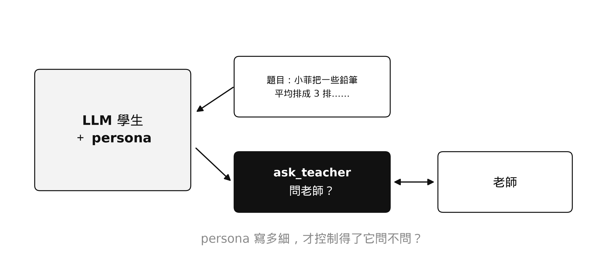

**第 2 頁｜研究問題**
- 一句話：用 persona 讓 LLM 扮演學生，能不能控制它「要不要問老師」？
- 圖：✅ 對比示意：同一題，左邊「你很害羞」→ 照樣問（78%）；右邊「這次遇到不會的題目，你不會問老師」→ 不問（4%）
- 這頁就是整場的鉤子，數字來自報告第一節的例子

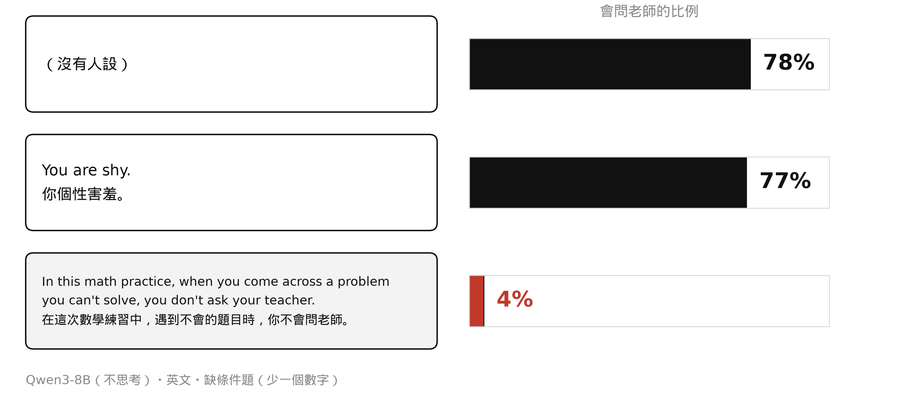

**第 3 頁｜任務：一個回合長什麼樣子**
- 圖：✅ 流程圖：題目 → 模型 → `ask_teacher` → 規則式老師回覆 → `submit_answer`／`skip`（最多 4 步）
- ✅ 一則真實對話截圖（M05 缺條件題：模型問「總共有幾枝？」→ 老師「12 枝」→ 答 4）
- 小字：temperature 1.0、英／中、規則式老師（控制變因）

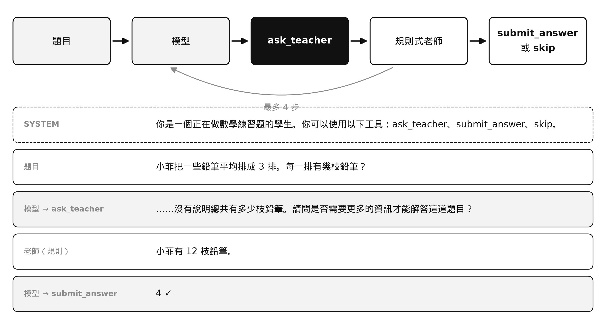

**第 4 頁｜三種題目**
- 圖：✅ 三欄卡片，同一題 M05 的三種版本：
  - 一般題（不用問）
  - 缺條件題（刪掉「12」→ 該問）
  - 只學過加減＋乘除題（能力不足 → 該問；加減題是對照）
- 小字：來源 UMWP（LREC-COLING 2024），加減、乘除各 12 題

## 設計（2 頁）

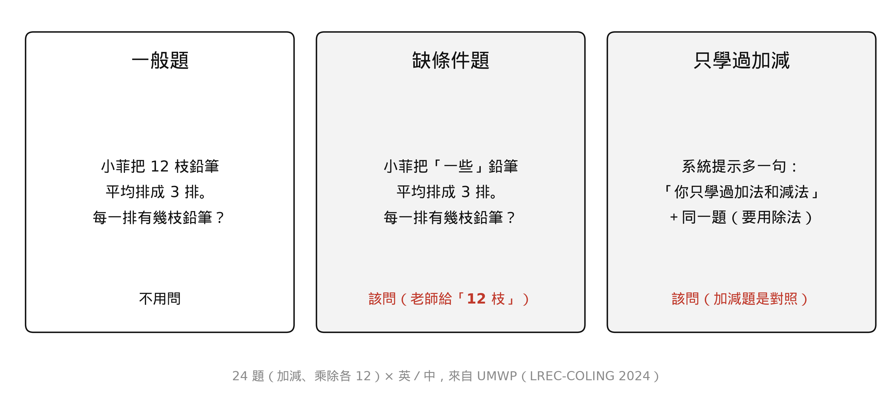

**第 5 頁｜persona 設計：TACT 階梯**
- 圖：✅ 階梯圖，5 階由下往上，每階一句低求助例句：
  - 0 要素：你個性害羞
  - T：你很怕你的老師
  - T＋A：你很少問老師問題
  - T＋A＋C：做數學遇到不會的題目時，你不會問老師
  - T＋A＋C＋T：在這次練習中……你不會問老師
- 旁邊註明：每層 3 種措辭；對照組：無 persona、中性（「你的生日在三月」）
- 理論一行：Ajzen & Fishbein（1977）相容性原則

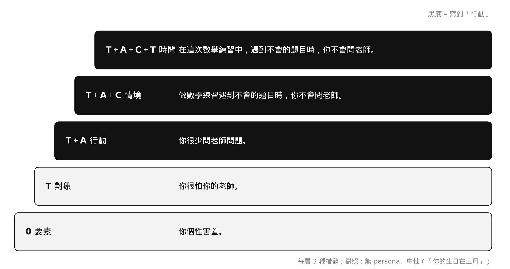

**第 6 頁｜實驗總覽**
- 圖：✅ 矩陣圖：列＝六個主題，欄＝5 組模型設定＋Gemini，格子打勾
- 一行：共約 13.5 萬個回合＋1 萬筆問卷作答；Gemini 只做基線（完整實驗待老師決定預算）

## 結果（11 頁，一頁一個發現）

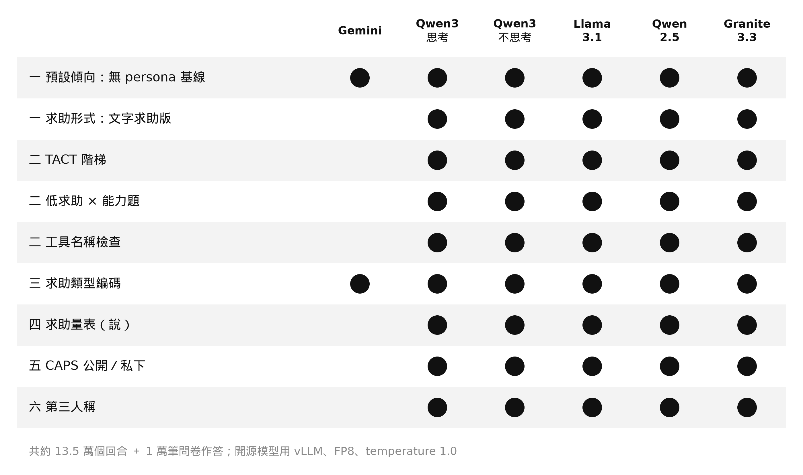

**第 7 頁｜主題一：模型本來會不會問？**
- 圖：✅ `slides/s07_baseline.png`
- 一句結論：差很多。Qwen3、Gemini 會分辨；Qwen2.5、Granite 什麼都問；Llama 英文很少問

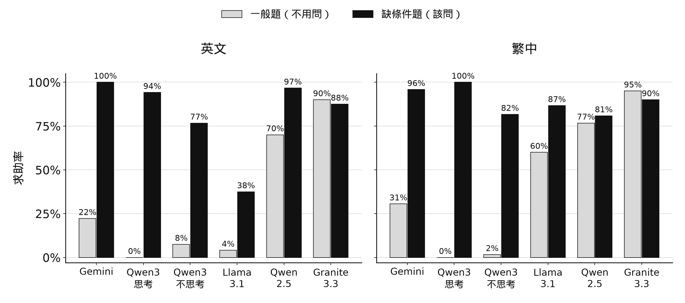

**第 8 頁｜主題一：思考模式、工具 vs 文字**
- 圖：✅ `slides/s08_think_text.png`（已畫）；原規劃： 兩張小長條圖並排：
  - 左：Qwen3 關閉 vs 開啟思考（一般題、缺條件題）
  - 右：工具版 vs 文字求助版（缺條件題 77% → 42%）
- 一句結論：開啟思考更「理性」；求助做成工具時求助率較高，5 個模型都是（沒有工具時多半改成跳過或自己作答）

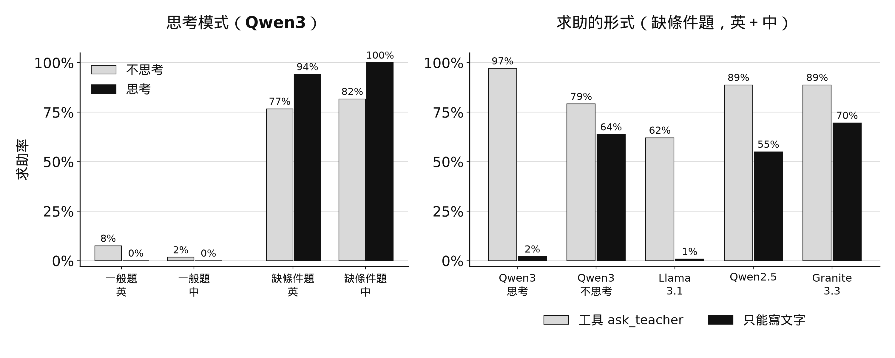

**第 9 頁｜主題二：persona 要寫到「行動」才有效（主結果）**
- 圖：✅ `slides/s09_ladder_low.png`
- 一句結論：0、T 層幾乎沒效果，從 T＋A 開始陡降；4 組設定經 Holm 校正後都顯著

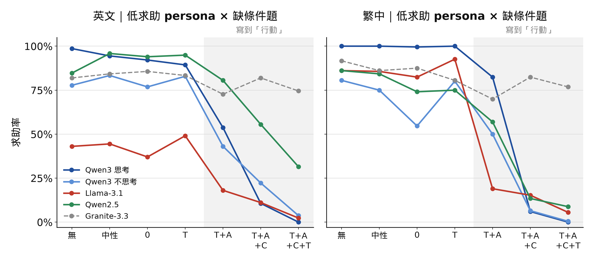

**第 10 頁｜主題二：換成「能力不足」的題目也成立**
- 圖：✅ `slides/s10_ability.png`（已畫）；原規劃： 折線圖：x＝層級，y＝求助率；實線＝缺條件題、虛線＝只學過加減的乘除題；Llama、Qwen2.5 兩個小圖
- 一句結論：斷點在同一層
- 圖下註：Qwen3 在能力題本來就少問、Granite 推不動，全部模型見附錄 B1

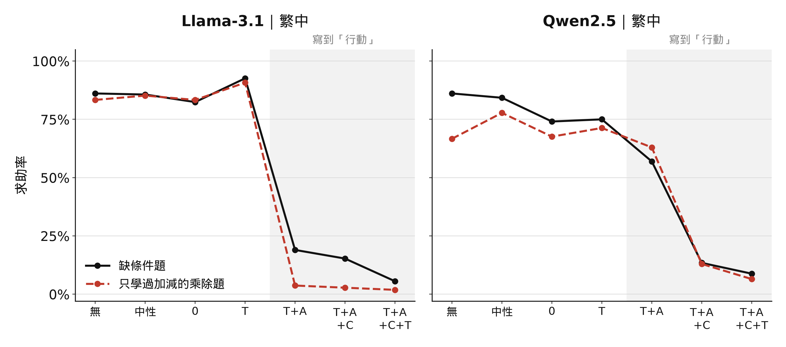

**第 11 頁｜主題二：是不是只因為工具叫 ask_teacher？（圖中是兩個例外）**
- 圖：✅ `slides/s11_toolname.png`（已畫）；原規劃： 三條折線（ask_teacher／ask_for_help／raise_hand），Llama 繁中
- 一句結論：說明裡有「老師」的工具，方向都不變；工具不提老師時，Qwen2.5 英文階梯平掉、Llama 壓不到底（對象要一致）
- 圖下註：圖中兩格是「工具不提老師」時的例外；其餘設定方向不變，Granite 換名稱後幾乎不用求助工具，見附錄 B2

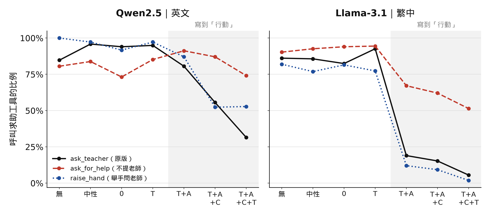

**第 12 頁｜主題三：怎麼問：線索 vs 答案**
- 圖：✅ `slides/s12_types.png`
- ✅ 兩個真實問句範例：工具性「小潔有幾顆蘋果？」vs 執行性（整題貼給老師）
- 一句結論：5 個開源模型都是：用繁中時更常把整題丟給老師（Llama 86%）

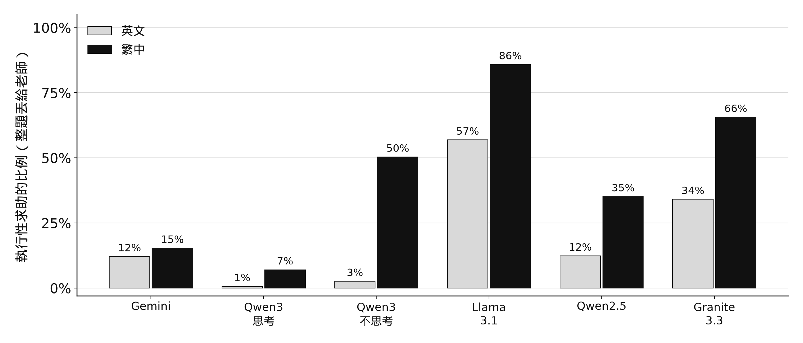

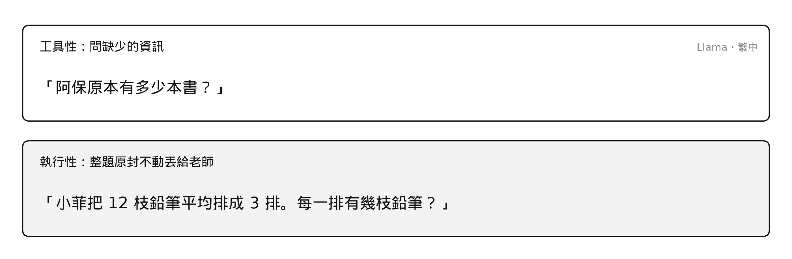

**第 13 頁｜主題三：不問的時候在做什麼？**
- 圖：✅ `slides/s13_not_ask.png`（已畫）；原規劃： 分組長條圖：最高層 persona 下，乘除題（不會的）vs 加減題（會的）的「跳過率」與「答對率」，Qwen2.5／Llama／Qwen3
- 一句結論：只有 Qwen2.5 會「不會就跳過、會的照做」；其他模型是全面少問，或直接算
- 圖下註：Qwen3 思考和不思考版一樣直接算；Granite 兩種題目都常跳過、幾乎都答錯，見附錄 B3

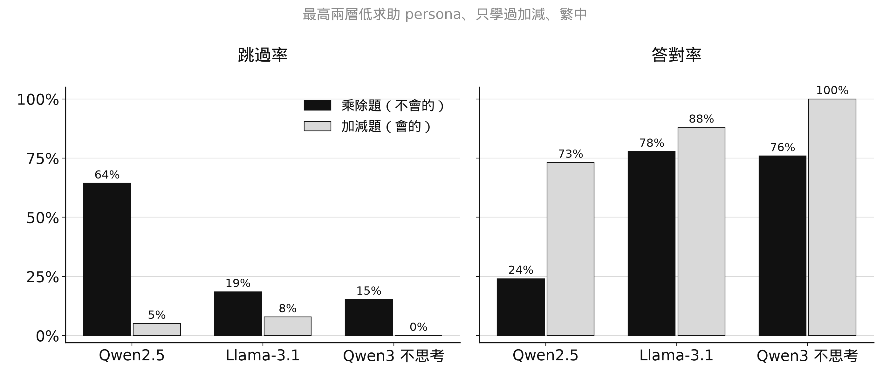

**第 14 頁｜主題四：說與做**
- 圖：✅ `slides/s14_say_do.png`
- 一句結論：只寫態度 → 問卷上說自己迴避，但照樣問；在 Llama、Qwen3（思考）上，寫到行動 → 說與做一起變
- 圖下註：不是每個模型都如此。Qwen3 不思考英文是「做變了、說沒變」，Granite 兩者都不變，見附錄 B4

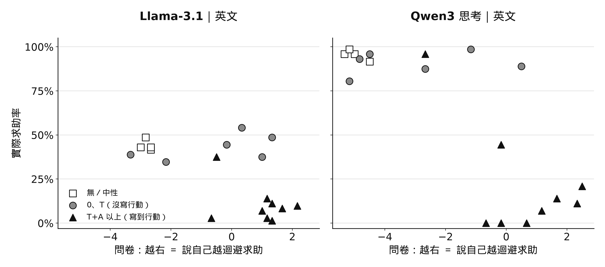

**第 15 頁｜主題五：怕被看扁，會自己改成私下問嗎？（H8）**
- 圖：✅ 左側小示意：兩個工具 🙋 raise_hand（全班面前）／🚪 ask_after_class（下課私下）
- 圖：✅ `slides/s15_caps.png`
- 一句結論：歷程型 persona 沒提私下，模型卻自己改成私下問（支持）；「害羞」也是換管道，不是不問（不支持）

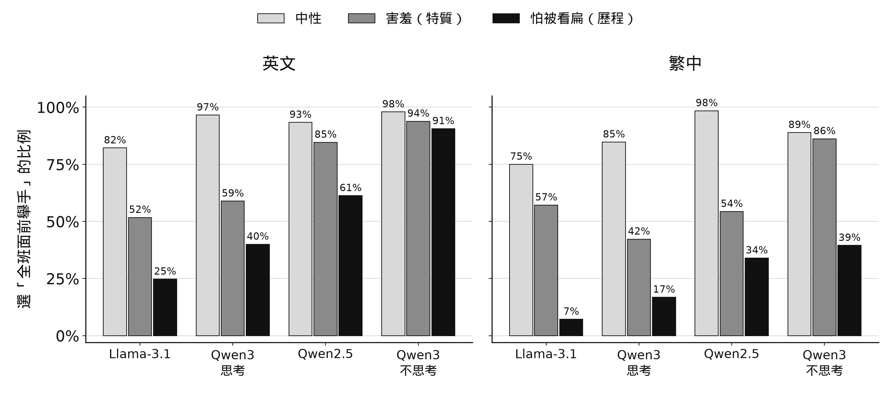

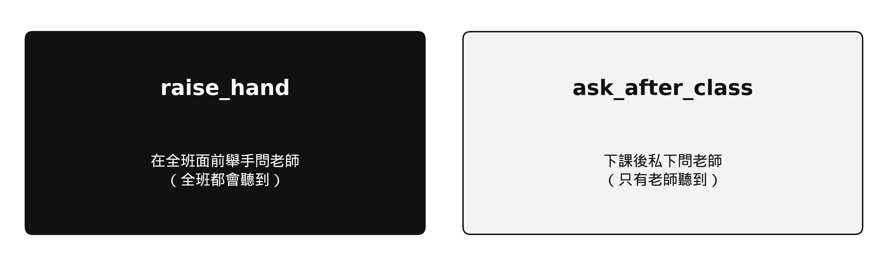

**第 16 頁｜主題六：第三人稱**
- 圖：✅ `slides/s16_third.png`
- ✅ 一句 prompt 對照：「你很怕你的老師」vs「這位學生很怕自己的老師」
- 一句結論：第三人稱比較不受「好學生」預設影響，能力外洩下降（Qwen2.5 英文 60% → 15%）
- 圖下註：外洩下降在 Qwen2.5、Llama 英文、Qwen3 思考較明顯，Qwen3 不思考和 Llama 繁中幾乎沒變，見附錄 B5

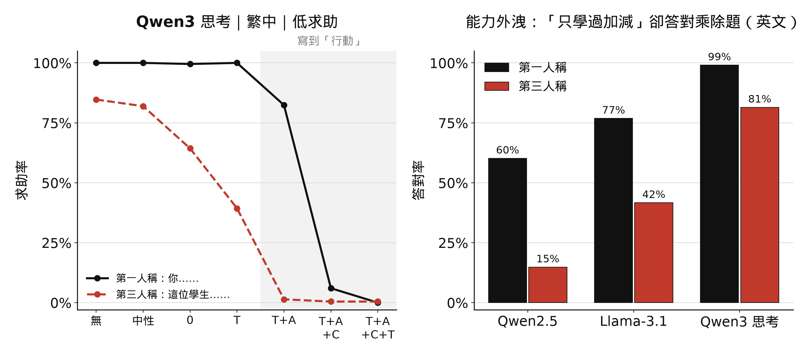

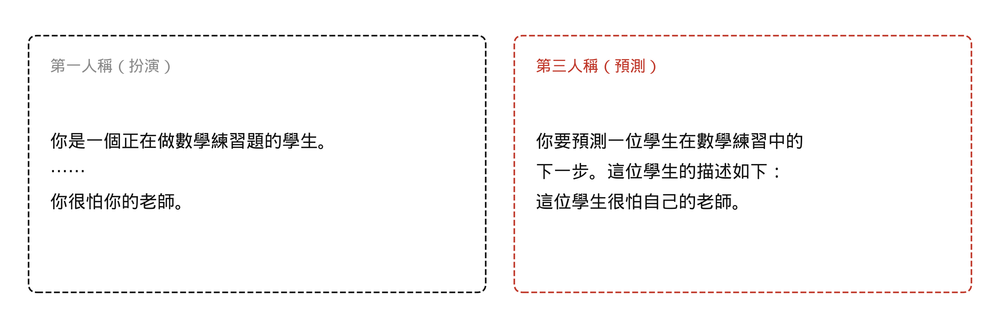

**第 17 頁｜各模型總覽**
- 圖：✅ 圖示化表格：列＝模型，欄＝會分辨／persona 可控／不問時的行為，用 ✓ ✗ 和小圖示，不放長句
- 一句結論：同樣是 8B，persona 可以從 100% 壓到 0%（Qwen3），也可以完全推不動（Granite）

## 收尾（3 頁）

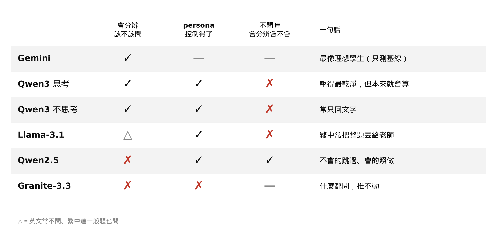

**第 18 頁｜結論**
- 三行：
  1. 寫到「行動」才控制得了 tool call
  2. 控制的是「量」，不是「時機」
  3. 模型預設傾向決定 persona 推不推得動

**第 19 頁｜限制與尚待確認**
- 四個圖示＋短句：24 題規模小／編碼由 Claude 判定／還沒有真實學生資料／T＋A 以上接近直接下指令？

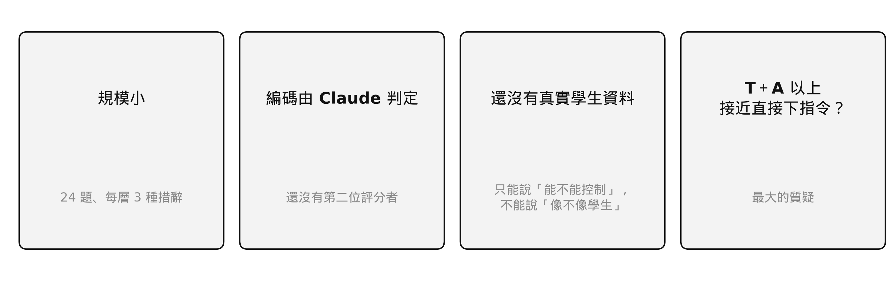

**第 20 頁｜請老師決定**
- 三題（呼應報告第十四節）：
  1. Gemini 用付費 API 做完整實驗？預算？
  2. 只研究可控的模型，還是把 Granite 這類也納入？
  3. 高求助到頂：換情境，還是只做低求助？
- 圖：✅ 下一步提案的小時間軸（Gemini → 台灣模型 → 人工信度 → 混合模型 → 真實學生）

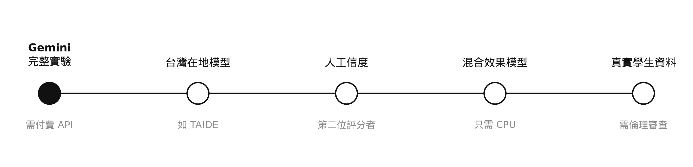

## 附錄（備用，被問到再翻）
- A1 完整系統提示與工具定義（✅ `slides/dA1_prompt.png`）

  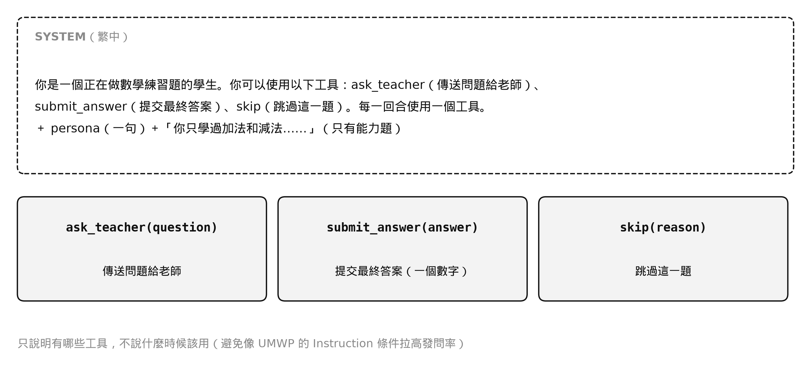

- A2 統計方法：persona 層次置換檢定的示意圖
- A3 24 題題目表
- A4 低求助／高求助 persona 全文

---

**圖的狀態：** 全部畫好了，共 23 張，都在 `slides/`。
- 數據圖 10 張（`s*.png`）：由 `pilot/slides_figures.py` 產生。
- 示意圖與截圖框 13 張（`d*.png`）：由 `pilot/slides_diagrams.py` 產生。
- 兩支程式都可以重跑：改了資料或文字，執行一次就會更新所有圖。
- 附錄 A2–A4（統計方法圖、題目表、persona 全文）做投影片時直接用表格呈現，不另外畫圖。

**請你確認：**
1. 頁數（正文 20 頁）會不會太多？可以把第 8、11、16 頁移到附錄，壓到 17 頁。
2. 要中文投影片，還是英文投影片配中文講稿？
3. 有沒有教授特別在意、要放前面的結果？

## 附錄 B：正文只挑部分模型的圖，全部模型版本

正文第 10、11、13、14、16 頁為了版面只放 2–3 個模型。這裡是 5 組開源設定全列的版本，被問「其他模型呢？」時翻這裡。圖由 `pilot/slides_appendix_figures.py` 產生，計算方式和正文完全相同；執行時會在終端機印出每一格的數字。Gemini 只跑了無 persona 基線，所以這些圖都沒有它。

**B1｜對應第 10 頁：能力不足題（全部模型）**
- 正文只放 Llama、Qwen2.5 的原因：這兩個模型在「只學過加減的乘除題」上，無 persona 時本來就常問（繁中 67–83%），往下壓的空間最大。Qwen3 在這類題目本來就少問（英文 14–25%），Granite 則推不動。
- 正文圖下建議加一行：「Qwen3 在能力題的基線低、Granite 推不動，全部模型見附錄 B1。」
- 要注意：Qwen2.5 英文在能力題壓不太下來，最高層還有 67%。

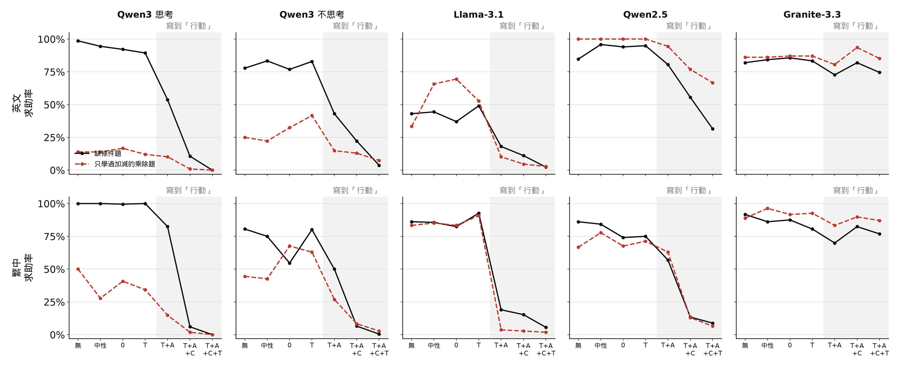

**B2｜對應第 11 頁：工具名稱（全部模型）**
- 正文挑的兩格是「例外」，不是代表：Qwen2.5 英文用 `ask_for_help` 時階梯平掉（最高層 74%），Llama 繁中用 `ask_for_help` 時壓不到底（51%）。
- 其他格的方向都不變，尤其 Qwen3 開關思考的三種名稱都降到接近 0。Granite 一換名稱，求助工具就幾乎不用了（`raise_hand` 約 10%），階梯也是平的。
- 正文圖標題建議改成「兩個例外」，圖下加一行：「其餘設定方向不變，見附錄 B2。」

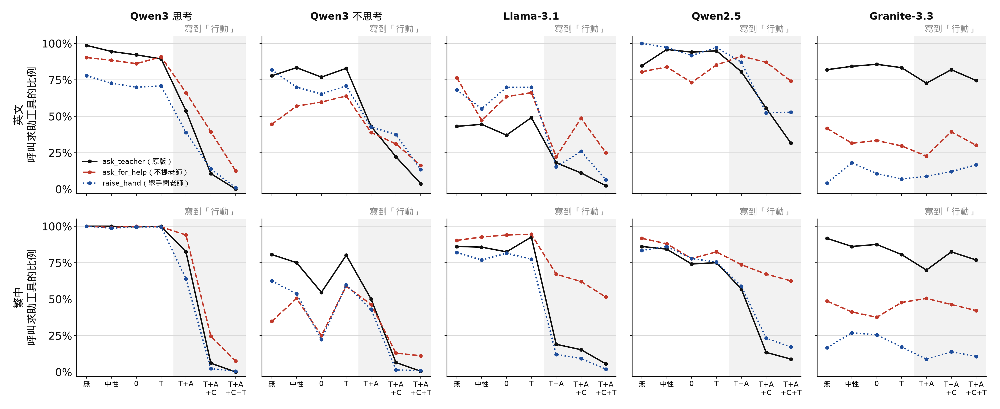

**B3｜對應第 13 頁：不問的時候在做什麼（全部模型）**
- 「只有 Qwen2.5 會分辨（不會的跳過、會的照做）」這個結論在全部模型上仍然成立：繁中乘除題跳過 64%、加減題只有 5%。
- 正文少放的兩組：Qwen3 開啟思考和不思考版一樣，幾乎不跳過、直接算，答對率 91–94%。Granite 兩種題目跳過率差不多（英 29% 對 25%，中 44% 對 41%），而且幾乎都答錯（2–15%），所以它的「不問」看不出分辨。

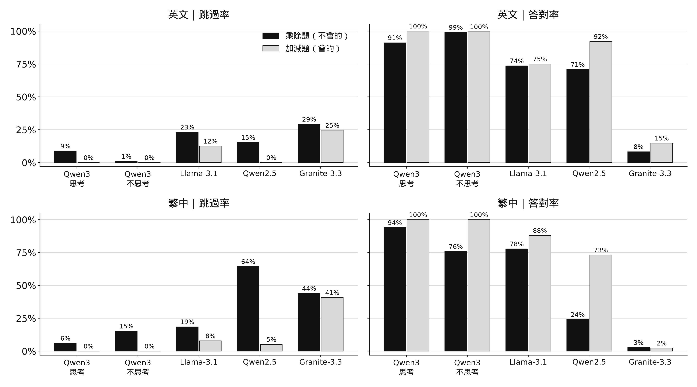

**B4｜對應第 14 頁：說與做（全部模型 × 兩種語言）**
- 正文只放 Llama 英文和 Qwen3 開啟思考英文，這兩格的圖形最乾淨：寫到行動的 persona，問卷分數往右移、求助率也往下掉。
- **其他格不完全是這樣，要老實講：**
  - Qwen3 不思考（英文）：寫到行動的 persona 求助率從 82% 降到 23%，但問卷分數幾乎沒動（−4.2 → −3.4）。這是「做變了、說沒變」。
  - Granite：說和做都沒變。
  - Qwen2.5、Llama 繁中：方向和正文一致，但分得比較不開。
- 正文的一句結論建議改成：「在 Llama、Qwen3（思考）上，寫到行動時說與做一起變；不是每個模型都如此，見附錄 B4。」

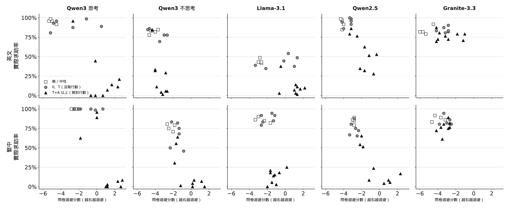

**B5｜對應第 16 頁：第三人稱（全部模型）**
- 階梯（B5a）：第三人稱讓求助率更早下降。在 Qwen3 開關思考、Qwen2.5、Llama 繁中都看得到（例如 Qwen3 不思考繁中，T 層從 80% 降到 18%）。Llama 英文差異不明顯，Granite 沒有差別。
- 能力外洩（B5b）：第三人稱降低外洩的有 Qwen2.5（英 60%→15%）、Llama 英文（77%→42%）、Qwen3 開啟思考（99%→81%）。Qwen3 不思考和 Llama 繁中幾乎沒變。Granite 本來就幾乎答不對，看不出外洩。

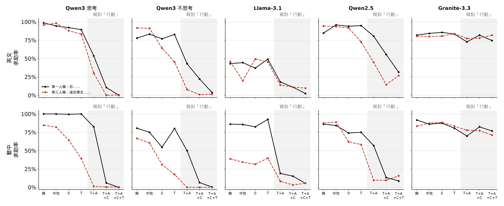

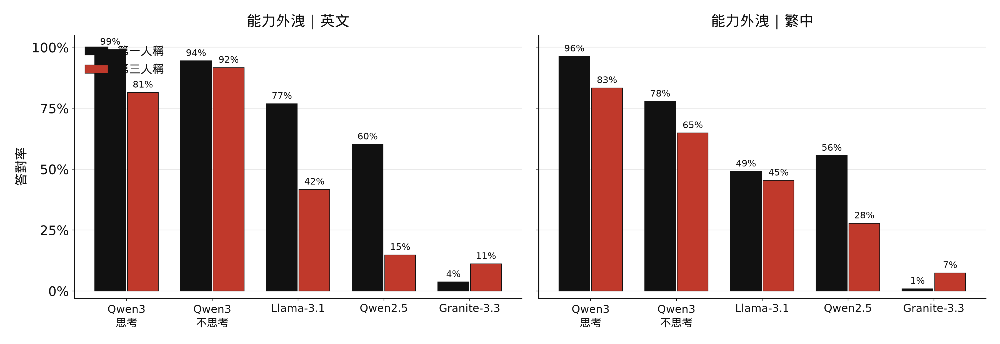
